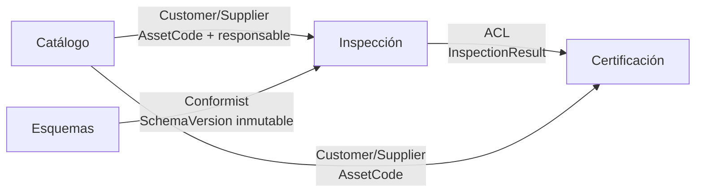
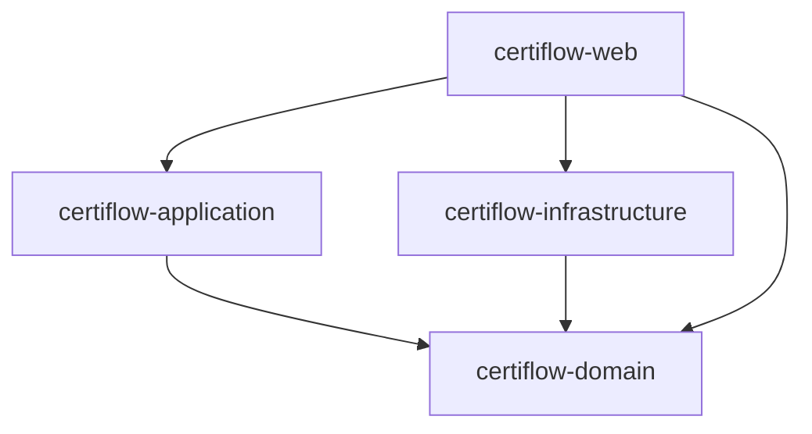

# Certiflow · Decisiones de diseño (Entrega 2)

Plataforma de inspección, habilitación y certificación de activos. Java 25, Maven, Spring Boot 4.1,
Spring Data JPA, Flyway, PostgreSQL (H2 en los tests), JUnit 6. Arquitectura DDD: el dominio y la
aplicación no dependen de ningún framework; Spring, JPA y Jackson viven en la infraestructura y en la
capa web. El código es el documento de diseño principal y este archivo explica por qué tiene la forma
que tiene.

```bash
mvn clean verify   # compila y prueba los cuatro módulos: dominio, aplicación, repositorios sobre H2 y API
```

La interfaz web vive en `certiflow-frontend/` (React y TypeScript), fuera del build de Maven, y trabaja contra la API; ver D22, D23 y D24.

---

## 1. Supuestos de negocio donde el enunciado es ambiguo

| # | Tema | Decisión | Consecuencia |
|---|---|---|---|
| S1 | Inspección iniciada | La asignación captura `schema.versionAt(startedAt)` con un único instante normalizado a microsegundos. La fecha prevista no selecciona versión. | Publicar o activar otra versión nunca modifica la captura. |
| S2 | Esquema y calendario | Un esquema por tipo; versiones consecutivas e inmutables, con publicación y vigencia separadas. Vigencias estrictamente crecientes e intervalos `[desde, próxima)`. | `latestPublishedVersion` puede diferir de `versionAt(now)`; publicación serializada por esquema. |
| S3 | Aprobado, observado, rechazado | La regla solo dice si la respuesta cumple. Si no cumple, la severidad del criterio decide: `MINOR` → `OBSERVED`; `MAJOR` y `CRITICAL` → `REJECTED`. Sin respuesta o sin la evidencia exigida: `PENDING`. | La decisión es un dato de `Severity`, no un condicional repartido por el código. |
| S4 | Hallazgos | Se levantan al cerrar la inspección, uno por criterio observado o rechazado, con la severidad del criterio, la evidencia adjunta y el responsable del activo. `close()` devuelve el evento `InspectionClosed` con las no conformidades, y `FindingService` genera los hallazgos a partir de él. Cerrar sin generarlos no es posible: el comando es de paquete y solo `InspectionService` lo expone (ver D14). | `Finding` es un agregado propio cuyo ciclo de vida sobrevive a la inspección. |
| S5 | Qué bloquea certificar | Lo decide `CertificationPolicy` según jurisdicción. La severidad solo determina la evaluación del criterio. | Políticas demo STRICT, CONDITIONAL y STANDARD; no hay fallback ni LEGACY. |
| S6 | Rectificación y hallazgos | Rectificar corrige el acta y su evaluación derivada; no toca los hallazgos ya levantados. Si la respuesta nueva deja el criterio en no conformidad y no hay un hallazgo **abierto** por esa misma no conformidad, se levanta uno nuevo, atribuido a quien rectificó. `rectify()` devuelve el evento `InspectionRectified` y `RectifyInspection` devuelve los hallazgos levantados. | Un hallazgo ya cerrado no tapa una no conformidad reintroducida por una rectificación: se levanta otro y el activo deja de ser certificable hasta cerrarlo. |
| S7 | Revisión original | Cerrar crea la `Revision` 1; cada rectificación agrega otra; ninguna se modifica. | `originalRevision()` devuelve siempre lo que se firmó al cerrar. |
| S8 | Acción correctiva | Vive dentro de su hallazgo. Está cerrada cuando tiene una verificación aceptada; está vencida cuando sigue abierta y la fecha es posterior a `dueDate`. El verificador debe ser distinto del responsable de la acción. Cuando se acepta una acción, el hallazgo cancela sus otras acciones abiertas y registra la `Cancellation` (quién verificó y cuándo). La fecha límite no puede ser anterior al día en que se planifica, y una verificación rechazada tiene que explicar por qué (`VerificationResult.requiresNotes()`). | Una verificación aceptada cierra acción y hallazgo a la vez, sin coordinación externa. Ninguna acción queda huérfana ni figura como vencida en un hallazgo cerrado. El día `dueDate` todavía no está vencida. |
| S9 | Vigencia | Plazo calculado por política; N días incluyen el día inicial y N meses terminan un día antes del aniversario ajustado. Ambos extremos inclusivos. | El request no acepta vencimiento libre; EXPIRED se deriva del reloj. |
| S10 | Unicidad y suspensión | A lo sumo un vigente por activo + alcance. Un suspendido dentro de vigencia ocupa su alcance. | Lock por activo evita emisiones concurrentes duplicadas; global y parciales tienen alcances distintos. |
| S11 | Renovación | Emite un certificado nuevo, basado en una inspección del mismo activo, cerrada después que la del certificado actual (7.3) y sujeta a la misma elegibilidad; el anterior pasa a `RENEWED`, estado terminal. No se modela "levantar una suspensión". Todo lo que puede fallar (elegibilidad, vigencia, `ensureRenewableWith`) se valida antes de pedir el número. | La historia no se borra. Menos transiciones que probar. Una renovación rechazada no consume numeración, cualquiera sea el motivo. |
| S12 | Límites numéricos | `Range[minimum, maximum]` cerrado en ambos extremos; un mínimo mayor que el máximo es configuración inválida. La unidad es configuración de la regla, no un dato libre de la respuesta numérica. | La inspección trabaja con el valor en la unidad que define su esquema; no hay conversión de unidades. |
| S13 | Evidencia obligatoria | Un criterio puede exigir una cantidad mínima de evidencias de un tipo concreto: `EvidenceRequirement(kind, minimum)`, a lo sumo un requisito por tipo. Cada evidencia exigida tiene que ser un archivo distinto: adjuntar dos veces la misma referencia al mismo criterio se rechaza (`DuplicateEvidenceException`). | Un criterio respondido pero sin la foto exigida queda `PENDING` y bloquea el cierre. "Dos fotos" no se cumple con la misma foto dos veces, y un criterio con dos requisitos del mismo tipo es un esquema inválido (`InvalidSchemaException`) en lugar de dos requisitos que se cumplen con una sola foto. El mismo archivo sí puede respaldar criterios distintos. |
| S14 | Personas | Inspector, responsable, verificador y emisor son `Person(id, name)`, una entidad identificada por `PersonId` (legajo o documento que asigna la organización) e igual solo por ese id. El rol lo da el campo que la referencia. | La regla "verificador distinto del responsable" compara identidades: dos homónimos son personas distintas y la misma persona se reconoce aunque su nombre se escriba distinto. |
| S15 | Identidad | Todo agregado tiene identidad: `AssetCode` (placa del activo), `CertificateNumber`, `PersonId`, e `InspectionId` y `FindingId` generados por su repositorio (`nextId()`). `CorrectiveActionId` numera las acciones dentro de su hallazgo. Entre agregados se referencia siempre por id, también el activo: `Inspection`, `Finding` y `Certificate` guardan su `AssetCode`, y los puertos consultan por código (`findByAsset(AssetCode)`, `findCurrentFor(AssetCode, fecha)`). | Los casos de uso reciben y devuelven ids; cargan el agregado con `findById` y lanzan `...NotFoundException` si no existe. Editar el nombre o el responsable de un activo no desvincula sus hallazgos ni su certificado. Ver D3. |
| S17 | Alcance | Una inspección parcial puede certificar un subsistema si cubre todos sus criterios. Un global de esquema descompuesto exige todos los parciales de la misma versión. | No se suman varias inspecciones para completar un parcial. |
| S18 | Características del activo | `Characteristics` es una colección de `Characteristic(name, value)` con nombres únicos (`DuplicateCharacteristicException`) y consulta `valueOf(name)`. | Reemplaza al `Map<String,String>`: los datos del activo se validan y se consultan con el vocabulario del dominio. |
| S19 | Independencia en la asignación | Quien asigna una inspección no puede realizarla (`AssignerCannotInspectException`); el responsable del activo no puede asignar su inspección (`AssetResponsibleCannotAssignInspectionException`) ni inspeccionarlo (`AssetResponsibleCannotInspectOwnAssetException`). Se valida al nacer la inspección. | La inspección la realiza alguien independiente de quien la pide y de quien responde por el activo. |
| S16 | Informes | `InspectionAct`, `FindingsSummary` y `CertificateDocument` son records sin formato. El acta solo se emite para inspecciones cerradas. | Son modelos de lectura: ahí se usan getters a propósito. |

---

## 2. Arquitectura: DDD estratégico y táctico

La arquitectura sigue Domain Driven Design como se vio en la Clase 7: bounded contexts con su lenguaje,
un context map explícito y, dentro de cada contexto, las piezas tácticas (entidades, value objects,
agregados, servicios de dominio, repositorios). Las capas siguen el diagrama DDD de la clase: `domain`
con las interfaces `UseCase` y `Repository`, `application` con su implementación, `infrastructure` con
los repositorios y `web` con los controladores.

### 2.1 Bounded contexts

| Contexto | Paquete | Lenguaje | Agregados y conceptos |
|---|---|---|---|
| **Catálogo** | `catalog` | activo, placa, tipo, ubicación, responsable, característica | `Asset`, `AssetCode`, `AssetType`, `Location`, `Characteristics` |
| **Esquemas** | `schema` | esquema, versión, sección, criterio, regla de aprobación, severidad, evidencia exigida | `InspectionSchema`, `SchemaVersion`, `SchemaSections`, `Section`, `Criterion`, `CriterionCode`, `SectionTitle`, reglas, `Severity`, `EvidenceKind`, `RawAnswer` |
| **Inspección** | `inspection` | inspección, alcance, respuesta, evidencia, observación, revisión, rectificación, hallazgo, acción correctiva, verificación | `Inspection`, `Evaluation`, `Revisions`, `Finding`, `CorrectiveActions` |
| **Certificación** | `certification` | certificado, vigencia, suspensión, renovación, elegibilidad, resultado de inspección | `Certificate`, `AssetCertificates`, `CertificationPolicy`, `CertificationEligibility`, `CertificationDecision`, `InspectionResult` |
| *Shared kernel* | `shared` | persona, auditoría | `Person`, `PersonId`, `Stamp`, `DomainException` y sus tres categorías (D28), `RequiredValueMissingException`, `AuditTrail`, `AuditEntry`, `AuditAction`, `AuditActionCatalog`, `AuditLog` |

Hallazgos y acciones correctivas quedan en **Inspección**: nacen del cierre y de la rectificación (S4, S6)
y comparten el lenguaje de la no conformidad (D15). Los informes son modelos de lectura del contexto que
los produce: acta y resumen de hallazgos en Inspección, documento del certificado en Certificación.

### 2.2 Context map



| Relación | Tipo | Cómo se implementa |
|---|---|---|
| Esquemas → Inspección | **Conformist** | La inspección captura la `SchemaVersion` vigente y la usa tal cual (S1). |
| Catálogo → Inspección | **Customer/Supplier** | La inspección guarda `AssetCode` y una foto del responsable (D3). |
| Catálogo → Certificación | **Customer/Supplier** | El certificado guarda `AssetCode`. |
| Inspección → Certificación | **Anticorruption Layer** | Certificación decide sobre su propio `InspectionResult`, que arma `InspectionResultTranslatorImpl` (D16). No importa `Finding` ni `InspectionView`: de Inspección solo conoce `InspectionId`, y lo verifica `ArchitectureRulesTest`. |

### 2.3 Módulos y capas



| Módulo | Paquetes (`<ctx>` = contexto) | Contiene | Depende de |
|---|---|---|---|
| `certiflow-domain` | `<ctx>.model` (+ `.exceptions`) | agregados, entidades, value objects, eventos, servicios de dominio, fábricas, snapshots | nada |
| | `<ctx>.repository` | interfaces de repositorio y `CertificateNumbering` | `model` |
| | `<ctx>.usecase` | una interfaz `XxxUseCase` por caso de uso, su `XxxCommand` (entrada) y sus modelos de lectura (salida) | `model` |
| `certiflow-application` | `application.<ctx>` | `XxxUseCaseImpl implements XxxUseCase`, el traductor del ACL | `domain` |
| `certiflow-infrastructure` | `infrastructure.<ctx>.persistence` | entidades JPA, Spring Data, adaptadores `JpaXxxRepository`, mappers de documentos JSON (`XxxDocumentMapper`), espejos de columnas | `domain`, Spring Data JPA, Flyway, Jackson |
| `certiflow-web` | `web.<ctx>`, `web.config`, `web.support` | controladores REST, DTOs, recursos HAL, composición, errores | todos, Spring Web, Spring HATEOAS |

La dirección de dependencias la impone el compilador: un módulo solo ve lo que declara. `certiflow-domain`
y `certiflow-application` no importan `org.springframework`, `jakarta.persistence` ni Jackson. Los
`XxxUseCaseImpl` se instancian como `@Bean` en las clases `XxxConfiguration` de `web.config`, que es la raíz de
composición, envueltos por el proxy transaccional (D20). Los tests de escenario (`CertiflowFixture`) usan esa
misma composición sobre H2.

Dentro de `model` se agrupa por contexto y no por tipo de clase, porque cada agregado y su fábrica
comparten visibilidad de paquete (el constructor del agregado es de paquete) y separarlos obligaría a
hacerlo público.

**Por qué `AuditLog` está en `shared.model`.** Es un puerto, pero su contrato (`AuditEntry`, `AuditAction`)
y los servicios de dominio que lo usan viven en `model`. Ponerlo en `repository` haría que `model` importe
`repository` mientras `repository` ya importa `model`: un ciclo.

**Negocio y detalles.** Las reglas de aprobación (`NumericRangeRule`, `YesNoRule`, `OptionInListRule`), las
respuestas y las escalas estándar de severidad y evidencia son negocio aunque se enchufen detrás de una
interfaz. Por eso viven en `schema.model`.

Dependencias entre contextos (cada línea se lee "importa"). Ya no se verifican a mano: `ArchitectureRulesTest`
(ArchUnit, en los tests de `certiflow-web`) hace fallar el build si alguna deja de cumplirse, junto con las
reglas entre capas y la de que dominio y aplicación no usan ningún framework.

```
shared         ->  (ningún contexto)
catalog        ->  shared
schema         ->  shared, catalog
inspection     ->  shared, catalog, schema
certification  ->  shared, catalog, schema, inspection           (de inspection solo InspectionId)
```

**Dónde vive cada validación.** Una regla vive dentro del agregado cuando puede decidirse con su propio
estado y debe cumplirse siempre, sin importar desde qué caso de uso se lo manipule. Por ejemplo, una
`Inspection` no puede cerrarse si tiene criterios pendientes; una `CorrectiveAction` no puede ser
verificada por su responsable; y un `Certificate` no puede renovarse dos veces. Estas reglas se validan
en los métodos del agregado antes de modificarlo.

Las reglas que necesitan consultar o coordinar más de un agregado viven en la capa que los orquesta.
Para certificar hay que mirar los hallazgos del activo: la regla es de negocio y vive en el servicio de
dominio `CertificationPolicy`, que recibe el `InspectionResult` ya armado por el ACL; para impedir dos
certificados vigentes se consulta el repositorio desde `IssueCertificate`; y para garantizar un único
esquema por `AssetType`, `CreateInspectionSchema` consulta el repositorio de esquemas antes de crear uno.
Así los agregados no dependen de repositorios ni conocen el resto del sistema.

**Tiempo.** Los casos de uso leen el `Clock` y le pasan `Instant` o `LocalDate` al dominio. El dominio es
determinista y los tests usan un reloj controlable.

### 2.4 Glosario (lenguaje ubicuo)

| Término | Definición | Clase |
|---|---|---|
| Activo | Instalación, laboratorio o equipo que se inspecciona y certifica, identificado por su placa | `Asset`, `AssetCode` |
| Tipo de activo | Clase de activo; define qué esquema de inspección le corresponde | `AssetType` |
| Responsable del activo | Persona que responde por el activo; se le atribuyen los hallazgos | `Asset.responsible()` |
| Esquema de inspección | Plantilla versionada de secciones y criterios para un tipo de activo | `InspectionSchema` |
| Versión de esquema | Contenido inmutable de un esquema publicado en un momento | `SchemaVersion` |
| Sección | Agrupación con título de criterios dentro de una versión | `Section` |
| Criterio | Pregunta o medición con su regla de aprobación, severidad y evidencia exigida | `Criterion` |
| Regla de aprobación | Condición que decide si una respuesta cumple el criterio | `ApprovalRule` |
| Severidad | Gravedad de incumplir un criterio: decide si queda observado o rechazado y si bloquea la certificación | `Severity`, `StandardSeverity` |
| Evidencia | Foto o documento adjunto a un criterio | `Evidence`, `AttachedEvidence` |
| Respuesta | Valor registrado para un criterio, con quién y cuándo | `GivenAnswer`, `RawAnswer` |
| Inspección | Ejecución de una versión del esquema sobre un activo por un inspector | `Inspection` |
| Alcance | Parte del esquema que cubre una inspección: completa o por secciones | `InspectionScope` |
| Evaluación | Resultado de cada criterio: aprobado, observado, rechazado o pendiente | `Evaluation`, `Outcome` |
| Cierre | Primera revisión de una inspección; la deja inalterable salvo por rectificación | `Revision` número 1 |
| Rectificación | Corrección auditable de una inspección cerrada; agrega una revisión | `Revision` |
| No conformidad | Criterio observado o rechazado | `CriterionResponse` con `Outcome.raisesFinding()` |
| Hallazgo | No conformidad levantada con su severidad, evidencia y responsable | `Finding` |
| Acción correctiva | Tarea planificada con vencimiento para resolver un hallazgo | `CorrectiveAction` |
| Verificación | Revisión de una acción por alguien distinto de su responsable; aceptada, cierra la acción y el hallazgo | `Verification` |
| Resultado de inspección | Lo que Certificación sabe de una inspección: cierre, alcance y no conformidades abiertas | `InspectionResult` |
| Elegibilidad | Decisión explicada de si un resultado puede respaldar un certificado | `CertificationDecision` |
| Certificado | Constancia de habilitación de un activo con su vigencia | `Certificate` |
| Vigencia | Período, con ambos extremos incluidos, en que el certificado vale | `ValidityPeriod` |
| Suspensión | Decisión registrada que deja un certificado sin efecto dentro de su vigencia | `Suspension` |
| Renovación | Emisión de un certificado nuevo que retira el anterior | `Certificate.renew` |
| Bitácora | Historial de quién hizo qué y cuándo sobre cada agregado | `AuditLog`, `AuditEntry` |

---

## 3. Decisiones principales

### D1. Reglas de aprobación: Strategy con el tipo de respuesta en la firma

- **Dónde:** `ApprovalRule<A extends Answer>`, `NumericRangeRule`, `YesNoRule`, `OptionInListRule`, `Criterion<A>`, `CriterionResponse<A>`, `Inspection.recordAnswer(Criterion<A>, A, ...)`.
- **Por qué:** agregar una regla es agregar una clase; nada más cambia. El contrato LSP es explícito en el tipo: `ApprovalRule<NumericAnswer>` declara qué acepta. Ofrecerle un `YesNoAnswer` a un criterio numérico **no compila**, así que ese error no necesita excepción ni test de ejecución. La unidad pertenece a la regla del criterio y la respuesta solo conserva el valor. `CriterionResponse<A>` lleva consigo su `Criterion<A>`, de modo que evaluar no requiere ningún cast.
- **Alternativas descartadas:**
  - *Double dispatch con métodos `default` que lanzan excepción:* funcionaba, pero la interfaz prometía tres capacidades y cada regla cumplía una. Es la violación de ISP de la clase 2 maquillada.
  - *Visitor con métodos abstractos:* obliga a cada regla a implementar "no soy yo" para los otros tipos.
  - *`instanceof` en la regla:* viola OCP y no es fiel al paradigma.
- **Costo:** comodines (`Criterion<?>`) en `Section` y `SchemaVersion`.
- **Qué cambia al agregar una regla (desde la revisión de calidad):** la regla nueva, su `ApprovalRuleKind` y una línea en el catálogo que arma la composición. La regla se describe con `describedBy(RuleDescriber)`, cuyos métodos son por clase de valor (`text`, `decimal`, `texts`) y no por tipo de regla, así que escribirla y leerla no toca ninguna interfaz del dominio ni la persistencia (D26). `SectionsDocumentMapperTest.aNewKindOfRuleIsStoredAndReadByRegisteringItWithoutChangingTheMapper` lo comprueba con una regla que el código de producción no conoce.

### D2. Conjuntos extensibles con interfaz más enum; vocabulario cerrado con enum simple

- **Principio:** OCP aplicado donde el cambio es previsible.
- **Dónde:** `Severity` + `StandardSeverity`; `EvidenceKind` + `StandardEvidenceKind`; `AuditAction` + `InspectionAudit`, `FindingAudit`, `CertificateAudit`.
- **Por qué:** las escalas de severidad y los tipos de evidencia los define cada entidad certificadora, y las acciones de auditoría crecen con cada agregado. Con la interfaz, sumar valores es sumar un enum, sin tocar el existente. Frente a un `record` con constantes, el enum evita crear un tipo nuevo por un error de tipeo.
- **Qué quedó como enum simple y por qué:** `Outcome`, `YesNoAnswer`, `VerificationResult`, `CertificateStatus`. Son vocabulario cerrado por el enunciado; si cambian, cambió el lenguaje del negocio y el dominio debe cambiar. Un punto de extensión ahí sería especulativo.
- **Quién nombra los enums:** solo la raíz de composición, que arma `SeverityCatalog`, `EvidenceKindCatalog`, `AuditActionCatalog` y `ApprovalRuleKindCatalog` con sus valores. Persistencia y API buscan por código en el catálogo (`withCode`), así una escala nueva se registra en un lugar. `AuditAction.code()` es el texto con el que se guarda (`InspectionAudit.CLOSED`), que distingue acciones de igual nombre en contextos distintos.
- **Costo:** quien implemente `Severity` o `EvidenceKind` fuera de un enum debe definir `equals`, porque `Criterion` se usa como clave.

### D3. Agregados con identidad y referencias entre agregados por id

- **Principio:** DDD; un agregado se referencia desde otro por su identidad, no por el objeto.
- **Dónde:** `InspectionId`, `FindingId` y `CorrectiveActionId` (records), además de `AssetCode`, `CertificateNumber` y `PersonId`. `Finding` guarda el `InspectionId` de su inspección; `Certificate` guarda un `InspectionReference(id, closedAt)`, con el instante de cierre que necesita la regla de renovación. `Inspection`, `Finding` y `Certificate` guardan el `AssetCode` del activo. `InspectionClosed` e `InspectionRectified` llevan el `InspectionId` y el `AssetCode`.
- **Por qué:** con referencias por objeto, un hallazgo o un certificado tenían acceso al agregado vivo de otro, y los casos de uso recibían agregados que quien llamaba podía modificar salteándolos (por ejemplo `inspection.close()` sin levantar hallazgos). Ahora los casos de uso reciben ids, cargan el agregado con `findById` y son el único punto de entrada para modificarlo. Los ids sintéticos los genera el repositorio (`nextId()`), así el dominio no depende de la estrategia de generación y sigue siendo determinista.
- **Por qué también el activo:** `Asset` es un record, así que su `equals` compara todos los campos. Mientras los agregados lo guardaban entero y los puertos consultaban `findByAsset(Asset)`, renombrar un activo o cambiarle el responsable habría dejado sus hallazgos invisibles para la consulta y al activo certificable. Con `AssetCode` la identidad es la placa, que es lo que el negocio identifica. Lo único que se conserva como foto es el responsable del activo al momento de asignar la inspección (`InspectionView.assetResponsible()`), porque es a quien se le atribuyen los hallazgos de esa inspección.
- **También la bitácora:** desde la Entrega 2 el `AuditLog` se indexa por la identidad del agregado (`AuditLog<InspectionId>`, etc.), así que el historial se encuentra aunque el agregado se haya reconstruido desde la base.
- **Costo:** cada caso de uso carga lo que necesita del repositorio y los tests leen el estado con `findById`.

### D4. `CorrectiveAction` dentro del agregado `Finding`

- **Principio:** frontera de consistencia; Tell, Don't Ask.
- **Dónde:** `Finding.planAction`, `Finding.verifyAction`; `CorrectiveAction.verify` es de paquete.
- **Por qué:** verificar con éxito una acción cierra el hallazgo. Si fueran dos agregados, esa reacción la tendría que orquestar un caso de uso. Adentro del mismo agregado es una consecuencia: `Finding.isOpen()` se deriva de sus acciones.
- **Costo:** un hallazgo con muchísimas acciones se carga entero; irrelevante a esta escala.

### D5. Estado derivado en lugar de almacenado

- **Dónde:** `Inspection.isClosed()` = tiene revisiones; `Finding.isOpen()` = ninguna acción verificada con éxito; `CorrectiveAction.isClosed()` e `isOverdueOn(date)`; `Certificate.statusOn(date)`; `Inspection.evaluate()`.
- **Por qué:** lo que no se guarda no puede quedar inconsistente. La evaluación se recalcula siempre desde las respuestas y las reglas, por eso corregir una respuesta cambia el resultado sin pasos extra.
- **Alternativa descartada:** `boolean closed`, `boolean expired`, enums de estado para hallazgos y acciones, resultados guardados junto a respuestas editables.
- **También derivados desde la revisión de calidad:** el alcance y la vigencia de un `Certificate` salen de su `GrantedDecision`; los subsistemas que exige una `SchemaVersion` salen de sus criterios (`SchemaSections.assignedSubsystems()`), y lo que declara quien publica se comprueba con `ensureRequires`; `FindingsSummary.openFindings()` se cuenta de sus líneas.
- **Excepción deliberada:** `CertificateLifecycle` (`ISSUED`, `SUSPENDED`, `RENEWED`) sí se guarda, porque suspender y renovar son decisiones de alguien y no se pueden deducir del calendario.

### D6. Ciclo de vida de la inspección: revisiones y guardas

- **Dónde:** `Inspection.revisions`, `ensureOpen()`, `ensureClosed()`, `Revision`.
- **Por qué:** una inspección cerrada es una inspección con al menos una revisión. `Revision` concentra lo que de otro modo serían un estado "cerrado" con datos y un registro de rectificación aparte. El antes y el después de una rectificación se obtienen comparando dos revisiones consecutivas.
- **Alternativa descartada:** patrón State con `Open` y `Closed`. Los dos estados no comparten ninguna operación válida, así que la interfaz común obligaba a implementar métodos que solo lanzan excepción. Ver sección 4.

### D7. Auditoría: cada agregado anota sus hechos y el caso de uso los vuelca a la bitácora

- **Principios:** SRP, OCP, DIP.
- **Dónde:** `AuditTrail` (en `shared.model`) dentro de `Inspection`, `Finding` y `Certificate`; `pullAuditEntries()` en cada agregado; puerto `AuditLog<S>` con `recordAll`; `AuditEntry`; `JpaAuditLog<S>`. Las fábricas (`InspectionFactory`, `FindingFactory`, `CertificateFactory`) solo crean.
- **Por qué:**
  - Los **hechos de dominio** que las reglas y los informes necesitan viven en el agregado: `Revision` (motivo, autor, fecha), `Verification`, `Suspension`, `Cancellation`, y desde D12 también el autor y la fecha de cada respuesta, evidencia adjunta y acción planificada.
  - La **bitácora** de quién hizo qué la produce el agregado: cada comando, al terminar sin errores, anota una `AuditEntry` en su `AuditTrail`. El nacimiento también se anota (el constructor registra `ASSIGNED`, `RAISED` o `ISSUED`). Si la operación lanza una excepción, no queda entrada.
  - El **servicio de dominio** vuelca las entradas al puerto apenas el comando termina: `auditLog.recordAll(aggregate, aggregate.pullAuditEntries())`. El agregado no conoce el puerto, y `pullAuditEntries()` es de paquete, así que nadie fuera del paquete puede vaciar la bitácora pendiente. Como el único camino al comando es el servicio (D14), auditar no depende de que el caso de uso se acuerde.
  - **Por qué no Decorator** (la versión anterior): cada `Audited...` reenviaba a mano todas las consultas, y agregar un método obligaba a tocar la interfaz, el `Standard...` y el `Audited...`. Ahora hay una sola clase por agregado; agregar un método toca solo esa clase.
  - **Un historial por tipo de agregado.** El puerto es `AuditLog<S> { record(S, AuditEntry); recordAll(S, List<AuditEntry>); historyOf(S) }` y cada agregado auditado tiene el suyo, indexado por su identidad: `AuditLog<InspectionId>`, `AuditLog<FindingId>` y `AuditLog<CertificateNumber>`. El alta de un activo también deja rastro: `AssetService` registra `AssetAudit.REGISTERED` en un `AuditLog<AssetCode>`. El esquema es inmutable y cambia de objeto con cada versión, así que su historial se indexa por su identidad de negocio: `AuditLog<AssetType>`, alimentado por `InspectionSchemaService`. `JpaAuditLog` guarda el tipo de sujeto y su id en `audit_entry`. Leer el historial es un caso de uso por contexto (`AssetHistoryUseCase`, `SchemaHistoryUseCase`, `InspectionHistoryUseCase`, `FindingHistoryUseCase`, `CertificateHistoryUseCase`): antes había un `AuditSubject` en el shared kernel que importaba todos los contextos.
  - La renovación tiene una sola forma de marcar el certificado reemplazado: `CertificateService.renew` crea el reemplazo con la fábrica y llama a `renewedBy`, que anota `RENEWED` en el anterior; el nuevo anota su propio `ISSUED`. El servicio vuelca ambos.
- **Alternativas descartadas:**
  - *Decorator por agregado:* ver arriba; era la versión de la Entrega 1 y la corrección señaló el reenvío manual.
  - *El agregado recibe el `AuditLog` y registra directamente:* evita el paso del caso de uso, pero el agregado quedaría acoplado a un puerto.
  - *Decorar casos de uso:* exige una interfaz genérica común a todos los casos de uso y audita con la granularidad equivocada, porque `CloseInspection` produce hechos de dos agregados.
  - *Bitácora global con `AuditEntry(Object subject, ...)`:* compilaba `entriesFor(asset)` y devolvía una lista vacía sin aviso. El sujeto como parámetro genérico del puerto dice qué se puede auditar.
- **Costo:** el volcado ocurre al ejecutar el comando, antes de que el caso de uso guarde el agregado. Desde la Entrega 2 los dos pasos corren en la misma transacción (D20): si el `save` falla, la entrada de bitácora también se descarta. Los tests de integración comprueban el historial de cada operación y `InspectionApiTest.aFailureAfterTheAuditEntryIsWrittenRollsTheEntryBack` que una entrada ya escrita se descarta si el guardado falla después.

### D8. Política de condicionales

- **Regla:** polimorfismo cuando la variación es por tipo y se espera que crezca; `if` común cuando es una decisión de negocio puntual que no va a crecer. No se busca "cero `if`" como fin en sí mismo: un condicional disfrazado (una tabla `Map` que hace de `switch`, un enum que solo existe para esquivar un `if`) es menos legible que el condicional.
- **Polimorfismo o enums con comportamiento:** reglas de aprobación (D1), `Severity`, `Outcome.raisesFinding`, `CertificateLifecycle.statusOn`, `InspectionScope`, estado derivado (D5). Cada `VerificationResult` conoce su propia `FindingAudit` (`result.audit()`), en lugar de una tabla `Map<VerificationResult, FindingAudit>`.
- **`if` común:** las cláusulas de guarda que lanzan una excepción (por ejemplo `Certificate.suspend` exige que el certificado esté `ACTIVE`) y decisiones puntuales como "si la verificación fue aceptada, cancelar las demás acciones" (`Finding.verifyAction`).
- **`Optional`** se usa solo como tipo de retorno donde la ausencia es un resultado legítimo: las búsquedas de repositorio y de catálogo, y `CriterionResponse.given()`. No se guarda en un campo ni se usa como control de flujo: una ausencia que es parte del modelo es una variante (D26).

### D9. Puertos segregados

- **Principios:** ISP, DIP.
- **Dónde:** `AssetRepository {save, findByCode}`, `InspectionSchemaRepository {save, findByAssetType}`, `InspectionRepository {nextId, save, findById}`, `FindingRepository {nextId, save, saveAll, findById, findByAsset}`, `CertificateRepository {save, findByNumber, findCurrentFor}`, `CertificateNumbering {next}`, `AuditLog<S> {record, recordAll, historyOf}`. Los seis primeros viven en el paquete `repository` de su contexto; `AuditLog` vive en `shared.model` por el motivo explicado en la sección 2. Las consultas por activo reciben `AssetCode`, no `Asset` (D3).
- **Por qué:** cada interfaz tiene lo que sus casos de uso usan. La única consulta con lógica, `findCurrentFor`, delega la decisión en `Certificate.isCurrentOn(date)`.

### D10. Certificación como Strategy por jurisdicción

- **Qué:** `CertificationPolicyResolver` selecciona una Strategy por `JurisdictionCode`. El servicio de dominio
  `CertificationEligibility` aplica lo que ninguna política puede pasar por alto (cierre y cobertura, como
  `Requirements`) y, si se cumple, delega en la Strategy. `CertificationAssessmentService`, en la aplicación, solo
  carga el activo y lee el reloj.
- **Dónde:** evaluación, emisión y renovación usan el mismo colaborador. Los informes generales no clasifican el bloqueo;
  la evaluación por inspección/alcance muestra los impedimentos y condiciones; se eliminó el bloqueo universal de `Severity` y `Finding`.
- **Por qué:** nuevas jurisdicciones se registran en configuración sin cambiar el servicio central. Las tres políticas
  de ejemplo se arman en `CertificationConfiguration`, el único lugar que asocia jurisdicción con política, así el
  modelo de certificación no nombra las severidades estándar. La decisión es `GrantedDecision` o `RejectedDecision`
  (D26): un certificado solo puede construirse con la primera.
- **Alternativas:** switch por jurisdicción, una clase por combinación de plazos y motor de reglas; descartados
  por acoplamiento o complejidad innecesaria. Se guardan la decisión completa y código de política para explicar cada certificado.

### D11. Errores explícitos

- Reglas de negocio: excepciones con nombre del dominio que extienden una de las tres categorías de `DomainException` (D28) (`InspectionAlreadyClosedException`, `CriterionNotInSchemaException`, `VerifierMustDifferFromResponsibleException`, `NotEligibleForCertificationException`, `AssetAlreadyCertifiedException`, entre otras).
- Toda regla del dominio lanza una `DomainException`, sin excepciones genéricas de Java. Un texto obligatorio vacío (nombre, código, descripción, motivo, referencia) lanza `RequiredValueMissingException` (`shared.model`), una sola clase porque es la misma regla en todos los casos.
- Los constructores validan reglas de dominio, no la forma del dato. `null` nunca es un valor válido en este código y por eso no se chequea: que un dato llegue nulo es un problema de entrada y lo valida el adaptador (los records de request). En dominio y aplicación no queda ningún `null`: las ausencias son variantes (D26).
- Las excepciones de dominio viven en un subpaquete `exceptions` dentro del paquete de su concepto (`catalog.model.exceptions`, `inspection.model.exceptions`, `certification.model.exceptions`, `schema.model.exceptions`); las del shared kernel, en `shared.model`. También las de reglas que cruzan agregados (`AssetAlreadyCertifiedException`, `SchemaAlreadyDefinedForAssetTypeException`, `AssetAlreadyRegisteredException`) y las de ids inexistentes (`...NotFoundException`) viven en el paquete de su concepto, en `model`.
- Las operaciones validan antes de mutar. El test `rectificationWithoutReasonIsRejectedAndChangesNothing` lo comprueba.

### D12. Quién y cuándo como hechos de dominio

- **Dónde:** `Stamp(author, instant)` es el quién y cuándo de cada hecho; `GivenAnswer(value, answered)`, `AttachedEvidence(evidence, attached)`, `CorrectiveAction.plannedBy()` y `plannedAt()`; `CriterionResponse` guarda su `Answering` y sus `attachments`.
- **Por qué:** registrar una respuesta, adjuntar evidencia y planificar una acción recibían quién y cuándo, pero el núcleo los descartaba y solo la bitácora los usaba. Observaciones, revisiones, verificaciones y suspensiones ya guardaban su autor y su fecha, así que era una inconsistencia. Ahora el dato vive en el agregado: corregir una respuesta produce un `GivenAnswer` nuevo, y el acta muestra quién respondió cada criterio sin consultar la auditoría.
- **Alternativa descartada:** exponer además `answer()` y `evidence()` públicos. Evitaba tocar `Finding` y el acta, pero ofrecía dos formas de pedir lo mismo y dejaba el dato nuevo sin ningún consumidor en producción.
- **Costo:** dos records más; autor y fecha quedan tanto en el dominio como en la bitácora, igual que ya ocurría con las revisiones.

### D13. Vista de solo lectura de la inspección

- **Principio:** ISP.
- **Dónde:** `InspectionView` declara las consultas; la clase `Inspection` la implementa y agrega los cinco comandos, todos de paquete (D14). `Certificate` recibe un `InspectionView` para validar su base (cerrada, del mismo activo, posterior al certificado que renueva) y guarda solo su referencia.
- **Por qué:** quien solo necesita leer la inspección no debería poder modificarla. Desde D3 los otros agregados guardan el id, y el `InspectionView` solo se usa como parámetro de lectura.
- **Costo:** una interfaz más. Los casos de uso de certificación y el acta siguen recibiendo `Inspection` aunque solo leen.

### D14. Los comandos de los agregados solo se alcanzan por un servicio de dominio

- **Principios:** frontera de consistencia; SRP; el modelo protege sus invariantes.
- **Dónde:** `InspectionService`, `FindingService`, `CertificateService` y `AssetService` (más `InspectionSchemaService`, que ya existía). Los comandos de `Inspection`, `Finding` y `Certificate` (`recordAnswer`, `attachEvidence`, `addObservation`, `close`, `rectify`, `planAction`, `verifyAction`, `suspend`, `renew`, `ensureRenewableWith`) y `pullAuditEntries()` pasaron a visibilidad de paquete; el servicio vive en el mismo paquete y es público.
- **Por qué:** antes los comandos eran públicos y los repositorios devuelven el agregado vivo, así que `findById(id).get().close(...)` compilaba desde cualquier clase de `application`: se podía cerrar una inspección sin levantar sus hallazgos y sin auditar. Ahora el compilador lo impide. Cada servicio hace las tres cosas que tienen que ocurrir juntas: ejecutar el comando, producir los hechos que arrastra (los hallazgos de un cierre o de una rectificación) y volcar la bitácora. El caso de uso queda con lo suyo: buscar por id, llamar al servicio y guardar.
- **Qué gana cada regla:** "toda no conformidad levanta su hallazgo" (S4, S6) ya no vive en el caso de uso; "quien emite y quien renueva exigen la misma elegibilidad" vive en el flujo compartido de `CertificationAssessmentService`; "el acta solo se emite sobre una inspección cerrada" vive en `Inspection.ensureClosed()`; "un activo no se registra dos veces" vive en `AssetService`.
- **Alternativa descartada:** que los servicios reciban también los repositorios y guarden ellos. Dejaría a los casos de uso sin nada que hacer, pero obligaría a que `model` importe `repository`, que hoy importa `model`: un ciclo entre paquetes (ver sección 2).
- **Costo:** cuatro clases más y una indirección en cada caso de uso. El agregado sigue sin validar que se lo guarde: si un caso de uso olvidara el `save`, el cambio se perdería (ver limitaciones).

### D15. Bounded contexts y context map

- **Principio:** DDD estratégico: Bounded Context, Ubiquitous Language, Context Mapping.
- **Dónde:** paquetes raíz `catalog`, `schema`, `inspection`, `certification` y el shared kernel `shared`, repetidos en los cuatro módulos (sección 2.1); context map en la sección 2.2; glosario en la 2.4.
- **Por qué:** la Entrega 1 tenía un único modelo (`models.*`) donde cualquier concepto podía usar a cualquier otro. Separar contextos hace explícito qué sabe cada parte del negocio de las demás y le da a cada relación un tipo con nombre: Conformist para el esquema, que la inspección copia sin traducir; Customer/Supplier para el activo, que los demás referencian por `AssetCode`; Anticorruption Layer entre Inspección y Certificación (D16).
- **Alternativas descartadas:**
  - *Un contexto propio para hallazgos y acciones correctivas:* un hallazgo nace del cierre o de la rectificación de una inspección y habla de sus criterios y evidencias. Separarlo exigiría un evento entre contextos para algo que hoy es consecuencia directa del cierre (S4, S6), sin ganar independencia real.
  - *Un módulo Maven por contexto:* el compilador impondría también la frontera entre contextos, pero con cuatro contextos por cuatro capas serían dieciséis módulos para un equipo de cinco personas. Las capas, que es donde la regla de dependencias importa más, sí son módulos.
- **Costo:** el shared kernel (`Person`, auditoría) obliga a coordinar cambios entre contextos; se mantiene chico a propósito.

### D16. Capa anticorrupción entre Inspección y Certificación

- **Principio:** DDD, Context Mapping (ACL); DIP.
- **Dónde:** `certification.model.InspectionResult`, `OpenNonConformity`, puerto `InspectionResultTranslator`; implementación `application.certification.InspectionResultTranslatorImpl`. `CertificationPolicy.evaluate(InspectionResult)`; `Certificate` recibe un `InspectionResult` para validar su base.
- **Por qué:** la regla de elegibilidad de entonces y `Certificate` importaban `Finding` e `InspectionView`, así que cualquier cambio en cómo se modela una inspección o un hallazgo llegaba a Certificación. Ahora Certificación tiene su propio modelo de lo que necesita saber (cierre, alcance completo, no conformidades abiertas con su severidad), y el traductor es el único lugar que conoce los dos modelos. Es la base de F1 y F3: los resultados por subsistema y las políticas por jurisdicción se agregan sobre `InspectionResult` sin tocar Inspección.
- **Alternativas descartadas:** *que Certificación siga leyendo `Finding`:* más corto, pero mantiene el acoplamiento que la arquitectura pedía cortar; *un evento `InspectionClosed` que Certificación escuche y guarde:* sumaría una proyección persistida sin un caso de uso que la necesite.
- **Desde la revisión de calidad:** `InspectionResult` lleva un `InspectionClosure` (`StillOpen` o `ClosedAt`) en lugar de un instante que podía faltar, y lanza su propia `InspectionNotClosedForCertificationException`: ya no importa excepciones de Inspección. El puerto ofrece además `assetCodeOf(InspectionId)`, que emitir usa para bloquear el activo (D27) sin leer el repositorio de inspecciones.
- **Costo:** el traductor carga la inspección y los hallazgos del activo en cada decisión. `InspectionResult` repite datos que ya están en Inspección, a propósito.

### D17. Casos de uso con comandos y respuesta cruda tipada por la regla

- **Principio:** DDD táctico (Command de entrada, Response de salida, como en el diagrama de la Clase 7); preserva D1.
- **Dónde:** un `XxxCommand` (record) por caso de uso de escritura en `<ctx>.usecase`; `RawAnswer(String text)` en `schema.model`; `ApprovalRule.answerFrom(RawAnswer)`, `Criterion.answerFrom`, `SchemaVersion.criterion(CriterionCode)`; comandos por código en `InspectionService`.
- **Por qué:** los casos de uso recibían `Criterion<A>` y `A`, objetos que un cliente de la API no puede construir. Ahora reciben el código del criterio y el valor tal como llega. La versión de la inspección resuelve el criterio y su regla convierte el valor en la respuesta tipada; recién ahí se llama al comando genérico de siempre, `Inspection.recordAnswer(Criterion<A>, A, …)`, que sigue sin compilar con un tipo incorrecto. La conversión es un único punto con su excepción (`AnswerTypeMismatchException`) y su test parametrizado (`RawAnswerTest`).
- **Alternativas descartadas:** *`instanceof` de la respuesta en el caso de uso:* repartiría la decisión por tipo fuera del dominio; *exponer el `Criterion` al cliente:* filtra el modelo al adaptador. **Reemplazado en la revisión de calidad:** `RawAnswer` era un tipo sellado (`Number`, `YesNo`, `Option`) y cada regla le preguntaba el tipo con `instanceof`. Ahora lleva el texto tal como llegó y cada regla interpreta el suyo: la numérica lo lee como decimal, la de sí/no acepta `true` y `false`, la de opciones lo toma como está. La contracara es que `"7"` vale para un criterio numérico y `"true"` para uno de sí/no, que antes se rechazaban por venir entre comillas.
- **Costo:** catorce records de comando y un método más en cada regla.

### D18. Reconstrucción de agregados con snapshots (Memento)

- **Principio:** patrón Memento; el modelo protege sus invariantes; independencia de la base de datos.
- **Dónde:** `InspectionSnapshot`, `FindingSnapshot`, `CorrectiveActionSnapshot`, `CertificateSnapshot`; `snapshot()` en cada agregado; `XxxFactory.restore(snapshot)` usa un constructor de paquete distinto al de creación. `Asset` e `InspectionSchema` son records inmutables y no lo necesitan.
- **Por qué:** los constructores de `Inspection`, `Finding` y `Certificate` validan reglas de nacimiento y anotan `ASSIGNED`, `RAISED` o `ISSUED`. Reconstruir con ellos repetiría validaciones y auditoría en cada lectura. El snapshot es un record inmutable con todo el estado; el repositorio solo traduce snapshots a filas y de vuelta, sin tocar campos privados. Los comandos siguen siendo de paquete (D14): `restore` no abre ningún camino para modificar el agregado. `SnapshotTest` comprueba que restaurar y volver a tomar el snapshot da el mismo resultado y que un agregado restaurado se comporta igual.
- **Alternativas descartadas:** *anotar el dominio con `@Entity`:* mete JPA en el dominio y obliga a constructores vacíos y setters; *reflexión sobre campos privados:* rompe el encapsulamiento sin que el compilador lo vea.
- **Costo:** un record y un `restore` por agregado; un campo nuevo exige tocar el snapshot y su mapeo. Los snapshots y `restore` son públicos porque la persistencia vive en otro módulo: quien arma un snapshot a mano puede restaurar un agregado en un estado que ningún comando produce. Se acepta: el único que los construye es el adaptador JPA, y `SnapshotTest` cubre la ida y vuelta.

### D19. Persistencia: entidades JPA propias, JSON para lo inmutable

- **Principio:** Repository (DDD) como adaptador; aislamiento del dominio.
- **Dónde:** `infrastructure.<ctx>.persistence`: `XxxEntity` + `SpringDataXxxRepository` + `JpaXxxRepository implements XxxRepository`. Esquema SQL en `db/migration/V1__init.sql` (Flyway), igual en H2 y PostgreSQL; `ddl-auto=validate`.
- **Por qué:** las entidades JPA son de la infraestructura y se traducen a snapshots. Lo que se consulta o tiene identidad propia es tabla (activos, inspecciones, respuestas, evidencias, revisiones, hallazgos, acciones, verificaciones, certificados, suspensiones, bitácora). El árbol de secciones y criterios de una `SchemaVersion`, y la evaluación sellada en una revisión, son valores inmutables que siempre se leen enteros: van como JSON en una columna `text` (`SectionsDocumentMapper`, `EvaluationDocumentMapper`, `DecisionDocumentMapper`, sobre un único `StoredJson`). La escala de los decimales viaja intacta (`7.00` sigue siendo `7.00`). Los mappers son objetos que Spring crea y el repositorio le pasa al método de la entidad que los necesita, porque a una entidad la instancia JPA. Para traducir reglas, alcances, bases y respuestas a columnas, cada variante se describe a un receptor (D26) y se lee de vuelta con un lector por etiqueta guardada; no queda ningún `instanceof`.
- **Alternativas descartadas:** *jerarquía `SINGLE_TABLE` para las reglas y cuatro tablas para secciones y criterios:* mucho mapeo sin ninguna consulta que lo justifique; *guardar cada agregado entero como un documento JSON:* más simple, pero pierde las consultas por activo y la integridad referencial.
- **Costo:** severidades, tipos de evidencia y acciones de bitácora se persisten por código y se resuelven contra los catálogos (D2); un código guardado que nadie reconoce es `UnreadableStoredDataException`. Cinco columnas se siguen escribiendo y ya no se leen, porque el dato se lee de otro lado: `criterion_response.answer_type` (la regla del criterio sabe el tipo) y `certificate.scope_type`, `subsystem_code`, `valid_from`, `valid_until` (salen de la decisión guardada). Quitarlas sería una migración.

### D20. Transacciones con un proxy genérico

- **Principio:** Decorator; DIP; la capa de aplicación no depende de frameworks.
- **Dónde:** `web.config.TransactionalUseCases.wrap(Class<U>, U, TransactionTemplate)`: un proxy dinámico de la interfaz del caso de uso que ejecuta cada llamada dentro de una transacción. Las clases `XxxConfiguration` envuelven cada `XxxUseCaseImpl`.
- **Por qué:** auditar y guardar tienen que ser atómicos (era una limitación de la Entrega 1). Con el proxy, la bitácora y el `save` del agregado se confirman o se descartan juntos, y `application` sigue sin conocer Spring. Una sola clase sirve para todos los casos de uso.
- **Alternativas descartadas:** *`@Transactional` en los `UseCaseImpl`:* acopla `application` a Spring; *un decorador escrito a mano por caso de uso:* veintisiete clases que solo reenvían.
- **Costo:** las excepciones viajan desenvueltas desde el proxy; un caso de uso que necesitara otra propagación transaccional requeriría otra configuración.

### D21. API REST de nivel 3

- **Principio:** REST (Fielding): recursos, interfaz uniforme, hipermedia; nivel 3 del modelo de Richardson.
- **Dónde:** `certiflow-web`: `AssetController`, `SchemaController`, `InspectionController`, `FindingController`, `CertificateController`, `RootController`; `ApiExceptionHandler`; `ActingPersonResolver`; `PageLinks`.
- **Por qué:**
  - Las rutas son sustantivos; ninguna lleva un verbo. Cada operación de negocio crea el recurso que produce: cerrar crea el **cierre** (`POST /inspections/{id}/closure`, revisión 1), rectificar una **rectificación**, suspender una **suspensión**, renovar una **renovación**, verificar una **verificación**. Los nombres coinciden con las clases del dominio (`Revision`, `Suspension`, `Verification`).
  - Semántica de métodos: `GET` sin efectos, `PUT` idempotente para la respuesta de un criterio, `POST` para crear. El único `DELETE` es el logout (`/tokens/current`, D25): el dominio no borra nada.
  - `201 Created` con `Location`; `204` en el `PUT`; errores en `application/problem+json` (RFC 9457) según la categoría de la excepción (D28): no encontrado → 404, valor inválido → 400, regla violada → 409, no certificable → 409 con las razones.
  - HAL con hipermedia según el estado: una inspección abierta ofrece `closure` y una cerrada `rectifications` y `act`; un certificado activo ofrece `suspensions` y `renewals` y uno renovado ninguno; un hallazgo cerrado deja de ofrecer `corrective-actions`.
  - `ETag` y `Cache-Control` en lo inmutable (versiones de esquema y revisiones); colecciones paginadas con `first`, `prev`, `next` y `last`; `GET /api/v1` como punto de entrada.
  - Sin estado: cada request se autentica (Basic o Bearer) y la persona que actúa sale de esa credencial (D25).
  - El contrato está descrito en [docs/openapi.yaml](docs/openapi.yaml) (OpenAPI 3.1, 50 operaciones): rutas, cuerpos, códigos de estado, roles por operación y qué significa cada `rel`. Se escribe a mano y no se genera: un generador documenta los cuerpos JSON pero no las transiciones, que son la parte que un cliente necesita entender.
- **Alternativas descartadas:** *endpoints con verbos (`/close`, `/renew`):* es RPC sobre HTTP; *un solo DTO por agregado para leer y escribir:* mezcla lo que el cliente manda con lo que el servidor calcula; *generar el contrato con springdoc:* una dependencia más y un documento que describe formas pero no afordancias.
- **Costo:** un request y un recurso por operación; los links se arman a mano según el estado.

### D22. Frontend sobre puertos

- **Principio:** DIP; los detalles dependen de las reglas de negocio (Clase 7). Strategy con selección por tipo para las reglas.
- **Dónde:** `certiflow-frontend/src`: `ports/` (una interfaz por contexto, con un método por caso de uso y su mismo comando), `composition.ts` (único archivo que conoce el adaptador), `ui/shared/ruleKinds.tsx` (registro de tipos de regla), `ports/certiflowContract.ts` (suite de contrato).
- **Por qué:**
  - La interfaz se construyó mientras la API seguía cambiando por F1, F2 y F3, contra una implementación en memoria de los puertos. Los puertos llevan los nombres de los casos de uso del dominio, que es lo estable; de dónde salen los datos es un detalle. Cuando la API quedó definida se escribió el adaptador HTTP (D23) y se cambió `composition.ts`: las pantallas no se tocaron salvo el control de fecha, que dependía del reloj en memoria.
  - Cada recurso llega con la lista de **acciones disponibles** en su estado (`actions`), y la pantalla muestra un botón por acción. Ninguna pantalla repite la regla "si está cerrada, entonces…". La lista sale de los `_links` de HAL (D21), que traen solo las transiciones válidas.
  - Todo lo que depende del tipo de regla de un criterio (campos del editor de esquemas, control con que se responde, texto de solo lectura) está en un registro con una entrada por tipo. Un tipo de criterio nuevo es una entrada más, sin tocar las pantallas.
  - Severidades, tipos de evidencia y jurisdicciones llegan como datos por `vocabulary()`, no como uniones cerradas, para respetar los conjuntos extensibles de D2 y el criterio de F3 de agregar una jurisdicción sin tocar el servicio.
  - La suite de contrato prueba el negocio contra el puerto, no contra una implementación: primero corrió contra la implementación en memoria y hoy corre, sin reescribirse, contra el adaptador HTTP y el backend real.
- **Alternativas descartadas:**
  - *Llamar a la API desde el primer día:* cada cambio de F1 a F3 habría roto pantallas ya terminadas.
  - *Datos fijos sin reglas:* no permitía recorrer el flujo (cerrar una inspección no levantaría hallazgos).
- **Costo:** mientras existió la implementación en memoria, las reglas de S1 a S19 estuvieron escritas dos veces. Se eliminó al conectar la API.

### D23. Adaptador HTTP del frontend y niveles de test

- **Principio:** Adapter; anticorrupción en el borde (las pantallas no conocen la forma de la API); separar lo que se prueba rápido de lo que se prueba de verdad.
- **Dónde:** `certiflow-frontend/src/adapters/http`: `HalClient` (fetch, headers, credenciales, errores, paginación), `actions.ts` (tabla `rel` → acción), `*Mapping.ts` (funciones puras de la respuesta de la API a los tipos del frontend), `Http*Port.ts`, `__fixtures__/` (respuestas reales). En el backend: `ListSchemasUseCase`, `ListJurisdictionsUseCase`, `RegisteredJurisdictions`, `VocabularyController`, y los campos y links nuevos de `FindingResource`, `FindingsSummaryResource` y `AssetController`.
- **Por qué:**
  - **Las URLs se arman, los links se siguen.** El adaptador construye la URL de un recurso con su identificador, porque las rutas del navegador llevan identificadores, y sigue los links de la respuesta para las acciones disponibles, la paginación y los recursos relacionados. Las acciones nunca se deducen del estado.
  - **Todo `href` se reduce a ruta y query.** La API mezcla links absolutos y relativos; seguido tal cual, un link absoluto saltearía el proxy del frontend y fallaría por origen cruzado.
  - **La traducción está en un solo lugar y es pura.** La API ya no serializa tipos del dominio (alcance y base llevan su `type`), pero devuelve la severidad como nombre o como etiqueta según el recurso y la inspección en tres recursos. Las funciones de `*Mapping.ts` absorben eso y se prueban contra respuestas reales guardadas, sin levantar nada.
  - **Las jurisdicciones salen del registro de políticas.** `ConfiguredPolicyResolver` implementa `RegisteredJurisdictions`, así la lista que ofrece el alta de activos es la misma que resuelve las políticas: registrar una jurisdicción en `CertificationConfiguration` alcanza.
  - **Dos niveles de test.** Los rápidos (cliente, mapeos, pantallas con puertos sustitutos) corren sin backend en el job `frontend`. La suite de contrato y los flujos por pantallas corren contra el backend real en el job `e2e`; cada test usa códigos y tipos de activo propios porque la base es compartida.
  - **Solo se agregó a la API.** Lista de esquemas, vocabulario, subsistema del hallazgo, identificador en el resumen y un link: ninguna respuesta existente cambió de forma.
- **Alternativas descartadas:**
  - *Cliente que descubre todo desde `GET /api/v1`:* más fiel a HATEOAS, más pedidos y más código para llegar a recursos cuyo identificador ya está en la ruta.
  - *Conservar el modo en memoria como alternativa:* dos implementaciones de las reglas que mantener iguales.
  - *Servir el frontend desde el jar o habilitar CORS:* el proxy del servidor de desarrollo resuelve el mismo origen sin tocar el build de Maven.
  - *Limpiar la base entre tests de contrato:* exigiría un endpoint de borrado en el backend solo para tests.
- **Costo:** el frontend no corre sin el backend. El adaptador depende de los nombres de campo del dominio que la API serializa directo. Leer una inspección son tres pedidos más la versión del esquema. Los casos que mueven la fecha (acción vencida, certificado expirado, versión que entra en vigencia) no se pueden probar desde el frontend, porque el reloj del servidor no se controla: los cubren los tests del backend.

### D24. Roles en la interfaz

- **Principio:** SRP y OCP en la presentación: una sola tabla de datos decide qué hace cada rol; las pantallas no nombran roles.
- **Dónde:** `certiflow-frontend/src/ui/app`: `roles.ts` (roles, secciones del menú y `roleThatMayDo`, el rol de cada acción), `roster.ts` (cada persona de ejemplo con su rol), `SessionContext` (persona y rol de quien ingresó, `permitted(actions)`), `LoginPage`, `Layout` y `routes.tsx`; `ui/shared/RoleNotices.tsx`.
- **Por qué:**
  - La interfaz le mostraba todas las acciones a cualquiera, como si una persona hiciera el proceso entero. Ahora hay seis roles (administradora, coordinadora de inspecciones, inspector, responsable del activo, verificador y oficial de certificación) y cada uno ve en el menú las secciones donde trabaja.
  - **Una acción se muestra si el sistema la permite y el rol puede.** `resource.actions` sigue significando "lo que el sistema permite en este estado" (D22, D23); la pantalla le aplica `permitted(...)`. Son dos preguntas distintas con dos dueños distintos: el estado lo decide el backend, el rol lo decide la interfaz.
  - **`roleThatMayDo` es un `Record` de acción a rol.** Como el compilador exige una entrada por acción, no puede quedar una acción sin rol ni con dos. Mover una acción de un rol a otro, o agregar un rol, es editar esa tabla.
  - **El rol viene con la persona.** Lo trae el token de quien ingresó (D25); antes se elegía en "Acting as", que ya no existe. Las reglas de independencia del dominio (S19, verificador distinto del responsable) se siguen cumpliendo solas, porque cada paso lo hace otra persona.
  - **Cada rol queda dentro de sus secciones.** Las rutas se agrupan por sección bajo `SectionGate`: fuera del menú se ve "Not available for your role". Los links pasan por `SectionLink`, que deduce la sección del destino y no muestra el link (ni el botón) si el rol no la abre; los paneles de otras secciones (inspecciones y certificados en la ficha de un activo) no se muestran ni piden sus datos. Entrar por URL a un formulario de una sección propia que el rol no usa muestra qué rol hace falta. Al principio las secciones ajenas se veían en solo lectura; se cerraron junto con las lecturas de la API (D25).
- **Alternativas descartadas:**
  - *Que el backend rechace por rol sin login:* el rol sería otro header que cualquiera puede escribir. Con el login de D25 la API sí aplica los roles.
  - *Elegir el rol aparte de la persona:* permite combinaciones sin sentido, como una inspectora que también verifica.
  - *Mostrar a cada persona solo sus registros:* exige definir quién ve todo y filtros que la API no ofrece.
  - *Preguntar por el rol en cada pantalla (`if (role === 'inspector')`):* reparte la tabla por toda la interfaz.
- **Costo:** la tabla de roles está dos veces, en `roles.ts` y en los `@AllowedRole`/`@ReadableBy` de la API (D25); un cambio de rol se hace en los dos. Un rol pierde contexto: el verificador ve el hallazgo (criterio, evidencia, severidad) pero no la inspección completa. Quien registra un activo ya no puede asignarle una inspección sin cambiar de persona, que es justamente lo buscado pero hace más largo un recorrido de demostración.

### D25. Autenticación y roles en la API

- **Principio:** REST sin estado (la autenticación viaja en cada request y no es un recurso); la regla junto a lo que protege; los detalles (usuarios, contraseñas, tokens) fuera del dominio.
- **Dónde:** `certiflow-infrastructure`: `infrastructure.security` (`UserAccountEntity`, `RevokedTokenEntity` y sus repositorios; tablas `user_account` y `revoked_token` en `V1__init.sql`). `certiflow-web`: `web.security` (`SecurityConfiguration`, `JwtProperties`, `TokenIssuer`, `IssueTokenAfterBasicFilter`, `NotRevokedValidator`, `UserAccountDetailsService`, `SecurityProblems`, `TokenController`, `StaffRole`, `AllowedRole`, `AllowedRoleInterceptor`, `DemoUsersSeeder`); `ActingPersonResolver` lee la persona de la credencial. En el frontend: `ports/AuthenticationPort`, `adapters/http/{CredentialSource,BrowserSession,PersonLogins}`, `ui/app/LoginPage` y `SessionContext`.
- **Por qué:**
  - **Se ingresa por cualquier path.** Cualquier request puede traer `Authorization: Basic`; si las credenciales son válidas, la respuesta (sea cual sea su estado) trae un JWT en `Authorization: Bearer` y su vencimiento en `Token-Expires`. No hay endpoint de login: autenticarse no crea ni cambia nada en el servidor, así que no es un recurso.
  - **La contraseña viaja una vez.** El cliente usa después el token (HMAC-SHA256, 1 hora, con `sub`, `name`, `role` y `jti`). El navegador guarda un token que vence, no la contraseña, y verificar la firma cuesta microsegundos contra los ~100 ms de BCrypt en cada request.
  - **El logout sí es un recurso: `DELETE /api/v1/tokens/current`.** Revocar cambia algo en el servidor (un token pasa a estar muerto), y en REST eso se hace sobre un recurso. `current` nombra la credencial con la que se habla, como `/users/me`: nadie puede revocar un token ajeno. Es el mismo esquema que el endpoint de revocación de OAuth 2.0 (RFC 7009).
  - **Los roles se aplican en la API.** Cada escritura lleva `@AllowedRole(StaffRole.X)` y `AllowedRoleInterceptor` la controla **antes** de leer el cuerpo: un rol equivocado recibe 403 aunque el cuerpo sea inválido. La tabla coincide con `roleThatMayDo` del frontend (D24).
  - **Cada rol lee solo sus secciones.** Cada controlador declara `@ReadableBy({...})` o `@ReadableByAnyone` y el mismo interceptor lo controla en los GET (403). Inspecciones las leen coordinadora, inspector y oficial de certificación; hallazgos y el resumen de hallazgos, responsable del activo y verificador; certificados, el oficial de certificación. Activos, esquemas y vocabulario los lee cualquiera, porque toda lista filtra por activo y mostrar una inspección o un hallazgo exige su versión de esquema. Un test exige que todo controlador con GET declare quién lo lee.
  - **Se ingresa con un nombre de usuario** (`ana.torres`), no con el id de la persona. El token lleva el id en `sub`: el dominio sigue registrando quién actuó por `PersonId`.
  - **La persona que actúa sale de la credencial.** Los controladores siguen recibiendo `@ActingPerson Person`; desaparecen los headers `X-Person-*`. Las reglas de independencia del dominio siguen comparando `PersonId`.
  - **Los usuarios no son dominio.** Quién actúa ya es una `Person`; cómo lo prueba es un detalle técnico. Por eso las cuentas viven en infraestructura y web, y `certiflow-domain` y `certiflow-application` no cambian.
  - **Clave y vencimiento por `@ConfigurationProperties`** (`certiflow.security.jwt.secret`, `ttl`), como en la clase 8. La clave se lee de `CERTIFLOW_JWT_SECRET`.
  - **El navegador no abre su diálogo de login:** `SecurityProblems` no manda `WWW-Authenticate: Basic` cuando el request trae `X-Requested-With: XMLHttpRequest`, que el frontend envía siempre.
- **Alternativas descartadas:**
  - *Endpoint de login (`POST /sessions`):* trata ingresar como un lugar; contradice que cualquier path autentique.
  - *Basic puro en cada request:* la contraseña quedaría guardada en el navegador y cada request pagaría BCrypt; sin vencimiento ni logout.
  - *Logout solo en el cliente:* más simple y del todo sin estado, pero un token copiado sirve hasta que vence.
  - *Sesión con cookie:* exige CSRF y estado en el servidor por cada usuario.
  - *Usuarios en `@ConfigurationProperties`:* sin tablas, pero agregar una persona exige redeploy.
  - *`@PreAuthorize`:* se evalúa después de leer el cuerpo, así que un rol equivocado con un cuerpo inválido recibía 400 en lugar de 403.
  - *Reglas por patrón de URL en la configuración de seguridad:* separa la regla del endpoint y un cambio de path la rompe sin aviso.
- **Costo:** la revocación agrega estado (la tabla `revoked_token`) y una consulta por request autenticado con token. Los usuarios se cargan por datos: no hay alta, baja ni cambio de contraseña. Cada persona tiene un solo rol.

### D26. Variantes que responden, receptores y ausencias sin `null`

- **Principio:** polimorfismo en lugar de preguntar el tipo; el modelo no tiene `null`.
- **Dónde:** `CertificationDecision` (`GrantedDecision`, `RejectedDecision`), `CertificationScope` (`WholeAssetScope`, `SubsystemScope`), `CertificateBasis` (`InspectionBasis`, `PartialCertificatesBasis`), `InspectionScope`, `Answer`, `ApprovalRule`, `ValidityTerm` (`MonthsTerm`, `DaysTerm`); y las ausencias: `SubsystemAssociation` (`NoSubsystem`, `InSubsystem`), `Answering` (`NotAnswered`, `GivenAnswer`), `CancellationState` (`NotCancelled`, `Cancellation`), `InspectionClosure` (`StillOpen`, `ClosedAt`), `RequestedEffectiveDate` (`EffectiveOnPublication`, `EffectiveFrom`), `RequestedRenewalScope`.
- **Por qué:** antes había interfaces selladas sin métodos y quien las usaba hacía `switch` o `instanceof`, y varios records tenían un componente que podía ser `null` (el subsistema, la respuesta, la cancelación, el cierre). Ahora hay seis mecanismos, en este orden de preferencia:
  1. **El objeto responde.** La variante tiene el comportamiento: `scope.narrow(result)`, `basis.isSupportedOn(date, certificates)`, `answering.outcomeFor(criterion, evidence)`.
  2. **Describirse a un receptor.** Cuando alguien de afuera necesita los datos de cada variante para escribirlos (una columna, un JSON, un link), la variante tiene `<T> T describedBy(XxxDescriber<T>)`. El receptor **no tiene métodos `default` y ninguno lanza**: esa es la diferencia con el double dispatch que D1 descartó. Hay dos formas, según qué se espera que crezca:
     - *Un método por variante*, para las jerarquías cerradas, donde una tercera variante sería un cambio en el lenguaje del negocio (otorgada o rechazada, respondida o no, activo entero o subsistema). Lo que crece ahí son las operaciones (una columna, un JSON, un link), y una variante nueva no compila hasta que cada receptor la atiende.
     - *Un método por clase de valor*, para la jerarquía abierta: las reglas de aprobación. `RuleDescriber` tiene `text`, `decimal`, `texts` y `ofKind`; la regla dice su tipo y sus parámetros con nombre, y un `ApprovalRuleKind` la vuelve a armar desde un `RuleParameters`. Un tipo de regla nuevo no agrega ningún método a ninguna interfaz. Con un método por tipo de regla, como estaba al principio de esta revisión, cada regla nueva obligaba a tocar la interfaz del dominio y a todos sus implementadores, que es justo lo que D1 promete evitar.
  3. **La ausencia es una variante.** `NoSubsystem`, `NotAnswered`, `StillOpen` responden lo que corresponde a "no hay"; nadie pregunta si falta.
  4. **Elegir con `appliesTo`.** Para leer una etiqueta guardada o recibida (el tipo de una regla, el tipo de base) hay un lector por valor y se elige el primero que aplica; si ninguno aplica, el dato es ilegible.
  5. **La variante que no puede, lo dice con la excepción del negocio.** Cuando solo una variante puede cumplir un pedido, el pedido es una guarda y no una pregunta: `decision.ensureGranted()` devuelve la decisión otorgada o lanza `NotEligibleForCertificationException`; `basis.ensureBacksGlobalCertificate(number)` lanza `NotAGlobalCertificateException` si la base es una inspección; `closure.referenceOf(id)` lanza si la inspección sigue abierta. Reemplazan a `granted(): Optional`, a un booleano `backsGlobalCertificate()` y a un `Optional` que su único llamador convertía en excepción: los tres eran una pregunta por el tipo con otro nombre. No es el State que D6 descartó (ahí la mitad de las operaciones eran inválidas en cada estado): acá es una guarda sobre tipos cuyas demás operaciones valen para todas las variantes, y lo que lanza es la regla de negocio, no un "no soportado". Por lo mismo `CertificationDecision` ya no declara `conditions()` ni `ineligibilities()`: cada dato vive en la variante que lo tiene.
  6. **Objetos con colaboradores en lugar de estáticos.** Los utilitarios de persistencia y las reglas que eran métodos estáticos son objetos (`CertificationEligibility`, `AssetCertificates`, `Requirements`, `SchemaSections`, los `XxxDocumentMapper`).
- **Fronteras donde sí hay un nulo:** los espejos de un formato externo (records de request, documentos JSON guardados, columnas JPA) pueden tener un componente que falta. Lo convierten en un único método del espejo (`SubsystemColumn.association()`, `StoredAnswering`, `StoredCancellation`, `VersionRequest.requestedEffectiveDate()`), y de ahí para adentro no existe. Una regla se guarda con su tipo y solo sus parámetros (`StoredRuleDescriber`); las filas anteriores, que además traen vacíos los parámetros de los otros tipos, se siguen leyendo (`StoredRuleParameters` trata un parámetro vacío como uno que no está).
- **Value objects nuevos:** `CriterionCode`, `SectionTitle` y `PolicyCode` reemplazan textos que viajaban por las mismas firmas que otros textos. Persistencia y API escriben `value()`, así que ni lo guardado ni el JSON cambian. `OpenNonConformity` y `CertificationCondition` conservan el código de criterio como texto: Certificación guarda su copia y no depende del modelo de Esquemas.
- **Alternativas descartadas:** *seguir con `sealed` + `switch`:* el compilador avisa de la variante que falta, pero cada consumidor repite la pregunta por el tipo, que es lo que el paradigma pide evitar; *`Optional` como campo:* es el mismo nulo con otro nombre.
- **Costo:** más tipos chicos (una interfaz, sus variantes y su receptor por concepto) y una indirección al escribir. `CriterionResponse.given()` sigue devolviendo `Optional` porque la API todavía lo consume así (ver limitaciones).

### D27. El bloqueo del activo es explícito en cada caso de uso

- **Principio:** lo que un caso de uso necesita para ser correcto se lee en el caso de uso.
- **Dónde:** puerto `AssetLock` (`catalog.repository`), `JpaAssetLock` (`select … for update` sobre la fila del activo); `assetCodeOf(…)` en `InspectionRepository`, `FindingRepository`, `CertificateRepository` e `InspectionResultTranslator`; los doce casos de uso que cambian algo de un activo: responder, adjuntar evidencia, observar, cerrar y rectificar una inspección; planificar y verificar una acción correctiva; emitir, renovar y suspender un certificado; emitir y renovar un global.
- **Por qué:** antes, ocho comandos implementaban `LocksAsset` con una clave hecha de una etiqueta de texto y un id, y `CertificationTransactionLocks`, en el paquete de persistencia de certificación, la convertía en el activo con SQL sobre las tablas de todos los contextos, envuelto alrededor de los veintiséis casos de uso. El shared kernel importaba tres contextos por esa clave. Ahora cada caso de uso **resuelve el código del activo con una consulta que no carga nada, bloquea, y recién después carga** lo que va a cambiar. Ese orden es parte del contrato: es lo que hace que dos comandos sobre el mismo activo se ejecuten de a uno.
- **Los cuatro que faltaban:** al principio solo bloqueaban los ocho que ya lo hacían con el mecanismo anterior. Responder, adjuntar evidencia, observar y planificar una acción leían su agregado y lo guardaban sin bloquear, así que un pedido que había leído una inspección abierta podía guardar después de que otro la cerrara. Lo encontró una auditoría externa; ahora los doce siguen el mismo orden.
- **Detalle:** renovar resuelve el activo desde el certificado que reemplaza (no desde la inspección nueva), para que el primer error siga siendo "el certificado no existe". Emitir lo resuelve por el puerto del ACL (D16).
- **Verificación:** `CloseInspectionUseCaseImplTest.theAssetIsLockedBeforeTheInspectionIsLoaded`, `RecordAnswerUseCaseImplTest.theAssetIsLockedBeforeTheInspectionIsLoadedAndTheAnswerIsSaved` e `IssueCertificateUseCaseImplTest.theAssetIsLockedBeforeDeciding` fijan el orden; `DeliveryFeaturesApiTest.everyWriteOnAnOpenInspectionWaitsForWhoeverHoldsItsAsset` y `planningACorrectiveActionWaitsForWhoeverHoldsTheAssetOfItsFinding` retienen el activo en otra transacción y comprueban que cada escritura espera; `DeliveryFeaturesApiTest.simultaneousIssuanceOfSameScopeHasOneWinnerAndRollsBackTheOther` corre sobre H2 y, con `PostgresFeatureApiTest`, sobre PostgreSQL.
- **Costo:** cada uno de esos casos de uso tiene un colaborador más. `TransactionalUseCases` (D20) no cambió.

### D28. La categoría de la excepción decide el estado HTTP

- **Principio:** OCP; el dominio dice qué pasó y la API decide cómo responderlo.
- **Dónde:** `NotFoundException`, `InvalidValueException` y `RuleViolationException` en `shared.model`, las tres abstractas bajo `DomainException`; `ApiExceptionHandler` con un método por categoría (404, 400, 409) y uno más específico para `NotEligibleForCertificationException`, que agrega los motivos.
- **Por qué:** el handler tenía un mapa de dieciocho clases a estados y respondía 409 a cualquier excepción que nadie hubiera registrado. Una excepción nueva caía en 409 sin que nadie lo decidiera. Ahora extiende la categoría que le corresponde y no hay nada que registrar; `ArchitectureRulesTest` impide extender `DomainException` directamente.
- **Criterio:** 404 cuando un identificador del request no nombra nada; 400 cuando un valor está mal por sí mismo, sin importar el estado del sistema; 409 cuando el estado de algo que existe impide la operación.
- **Qué cambió al aplicar el criterio:** pasaron de 409 a 400 `AssignerCannotInspectException`, `DueDateInThePastException`, `InvalidValidityPeriodException`, `RectificationReasonRequiredException` y `VerificationNotesRequiredException`. Ninguna pasó a 404. El frontend lee el título de un error de dominio y nunca su estado, así que no cambió.
- **Excepciones que se renombraron o nacieron** (cambia el `title` del problema): `AssetLacksRequiredSubsystemsException`, `DuplicateSubsystemCodeException`, `UnknownJurisdictionException`, `RenewalScopeMismatchException`, `NotAGlobalCertificateException`, `ReplacementForAnotherAssetException`, `InspectionNotClosedForCertificationException`, `InvalidPageRequestException`. El frontend las conoce en `DomainError.ts`.
- **Costo:** una excepción que hoy es 409 y mañana se quiere 400 exige cambiar de quién hereda.

### D29. El reloj entrega la precisión que se guarda

- **Dónde:** `SharedConfiguration.clock()` es `Clock.tick(Clock.systemUTC(), Duration.ofNanos(1_000))`; `VersionRequest.requestedEffectiveDate()` trunca a microsegundos la única fecha que manda el cliente.
- **Por qué:** PostgreSQL guarda microsegundos. Antes había un `StoredInstant.normalize` en el shared kernel que el dominio y cuatro casos de uso tenían que acordarse de llamar, y un `Instants.asStored` en persistencia que redondeaba donde el otro truncaba. Ahora el instante ya nace con la precisión guardada y nadie lo normaliza después.
- **Verificación:** `SharedConfigurationTest`, `VersionRequestTest`, `JpaInspectionRepositoryTest.aRevisionKeepsTheSamePrecisionAsTheAnswerItSealed`.
- **Costo:** un reloj de test tiene que entregar microsegundos; uno que entregue nanosegundos haría que lo leído de la base no sea igual a lo guardado.

### D30. Reglas de arquitectura ejecutables

- **Dónde:** `ArchitectureRulesTest` (ArchUnit) en los tests de `certiflow-web`, que es el módulo que ve a todos.
- **Qué comprueba:** el dominio no depende de otra capa; la aplicación no depende de infraestructura ni de web; dominio y aplicación no usan Spring, JPA ni Jackson; el shared kernel no importa ningún contexto; cada contexto solo conoce a los anteriores (sección 2.3); Certificación conoce una inspección solo por su id, y solo su traductor lee el contexto de Inspección; toda excepción de dominio pertenece a una de las tres categorías (D28).
- **Por qué:** las fronteras entre capas las impone el compilador porque son módulos, pero las fronteras entre contextos eran una convención que se revisaba con `grep`.
- **Costo:** una dependencia de test más.

---

## 4. Patrones que se decidió no aplicar

| Patrón | Por qué no | Consecuencia |
|---|---|---|
| **State** para la inspección | Abierta y cerrada no comparten operaciones válidas; la interfaz común forzaba métodos que solo lanzan excepción. Con guardas permitidas y el estado derivado de las revisiones, eran dos clases de estructura sin comportamiento. | Si aparecen más estados con comportamiento compartido (por ejemplo "en revisión"), habría que reconsiderarlo. |
| **Factory con selección** (clase 2, `applyFor`) | Resuelve elegir en ejecución entre implementaciones. Acá no hay nada que elegir: hay una sola clase de inspección y la selección regla-respuesta la resolvieron los genéricos. | Sí se aplica Factory como punto único de creación: los `...Factory` son el único punto público de creación, porque el constructor de cada agregado es de paquete. Son clases concretas; si aparece una segunda forma de crear agregados se extrae la interfaz en ese momento, como ocurrió en la clase con `CallCostCalculatorFactory`. |
| **Event Sourcing** | Los agregados anotan entradas de bitácora y `close()` devuelve el evento `InspectionClosed`, pero el estado se guarda tal cual, no se deriva del historial. | No se puede reconstruir el estado desde el historial. |
| **Herencia para tipos de activo o de evidencia** | El tipo es un dato. | `AssetType` es un value object; `EvidenceKind` un enum extensible. |
| **Colección de primera clase para toda lista** | Se aplica donde la colección tiene una invariante o un comportamiento propio: `Characteristics` (nombres únicos), `SchemaSections` (títulos y códigos únicos, búsqueda por título y por código, subsistemas asignados), `SchemaVersionLog` (numeración consecutiva, vigente en un instante), `AssetCertificates` (un certificado vigente por alcance), `Requirements` (qué reglas no cumple un candidato), `Evaluation` (resultado de cada criterio, pendientes, no conformidades), `Revisions` (numeración desde 1, la original no cambia) y `CorrectiveActions` (numeración dentro del hallazgo, cancelar las abiertas al aceptar una). | `suspensions()`, `verifications()` y `evidence()` siguen devolviendo `List` inmutable: son registros cronológicos sin regla propia, y envolverlos sumaría clases que solo reenvían. Si mañana una de ellas gana una regla (por ejemplo "no se puede suspender dos veces seguidas"), ahí se extrae su colección. |
| **CQRS** | Las consultas usan los mismos repositorios y devuelven el agregado, que desde afuera de su paquete solo se puede leer (D13, D14). No hay una necesidad de lectura que el modelo de escritura no cubra. | Si los informes o listados necesitan otra forma de los datos (por ejemplo un tablero por jurisdicción), se agrega un modelo de lectura propio. |
| **Event Sourcing** en la persistencia | La bitácora (`audit_entry`) registra quién hizo qué, pero el estado se persiste por snapshot. | No se puede reconstruir un agregado desde la bitácora; la bitácora es informativa. |
---

## 5. Riesgo de negocio → test que lo cubre

| Riesgo | Test |
|---|---|
| Una versión nueva del esquema altera una inspección en curso | `SchemaVersioningTest.newSchemaVersionDoesNotAffectAnInspectionAlreadyStarted` |
| Las inspecciones nuevas no toman la última versión | `SchemaVersioningTest.inspectionsAssignedAfterPublishingUseTheNewVersion` |
| Se cierra con criterios sin responder | `InspectionExecutionTest.inspectionCannotBeClosedWhileCriteriaRemainUnanswered` |
| Se cierra sin la evidencia obligatoria | `InspectionExecutionTest.answeredCriterionStaysPendingUntilItsRequiredEvidenceIsAttached` |
| La misma evidencia adjunta dos veces cuenta como dos | `InspectionExecutionTest.sameEvidenceCannotBeAttachedTwiceToTheSameCriterion` |
| Dos requisitos del mismo tipo se cumplen con una sola evidencia | `CriterionTest.criterionCannotRequireTheSameEvidenceKindTwice` |
| Corregir una respuesta no cambia la evaluación o no deja rastro | `InspectionExecutionTest.correctingAnAnswerBeforeClosingChangesTheEvaluationAndIsAudited` |
| Una inspección cerrada acepta cambios directos | `InspectionExecutionTest.closedInspectionRejectsNewAnswersEvidenceAndObservations` |
| Una operación rechazada deja igual una entrada de auditoría | `InspectionExecutionTest.closedInspectionRejectsNewAnswersEvidenceAndObservations` |
| Hallazgos con severidad, evidencia o responsable incorrectos | `FindingsTest.closingRaisesOneFindingPerNonConformityWithItsSeverityEvidenceAndAssetResponsible` |
| Acción vencida un día antes o un día después | `CorrectiveActionTest.actionIsOverdueOnlyAfterItsDueDate` (parametrizado) |
| Una verificación rechazada cierra algo | `CorrectiveActionTest.rejectedVerificationKeepsActionAndFindingOpenAndIsAudited` |
| Un hallazgo cerrado deja acciones huérfanas que siguen figurando como vencidas | `CorrectiveActionTest.acceptingAnActionCancelsTheOtherOpenActionsOfTheFindingSoNoneIsLeftOverdue`, `rejectedVerificationCancelsNothing` |
| Un dato obligatorio vacío escapa como error genérico de Java | `RequiredValueTest` |
| Dos homónimos se consideran la misma persona | `PersonTest`, `CorrectiveActionTest.namesakeOfTheResponsibleCanVerifyButTheResponsibleUnderAnotherSpellingCannot` |
| El alcance de una inspección no restringe qué se inspecciona, o una inspección parcial certifica | `InspectionScopeTest` |
| Características del activo duplicadas o vacías | `CharacteristicsTest` |
| Publicar una versión modifica el esquema existente, o el log de versiones tiene huecos | `SchemaVersioningTest.publishingAVersionYieldsANewSchemaAndLeavesThePreviousOneUntouched`, `SchemaVersionLogTest` |
| Ids repetidos, referencias por objeto entre agregados o ids inexistentes | `AggregateIdentityTest` |
| Quien asigna o el responsable del activo realizan la inspección | `InspectionAssignmentTest` |
| La creación de un esquema o de una versión no queda auditada | `SchemaVersioningTest.creatingTheSchemaAndAddingVersionsIsAudited` |
| El responsable de la acción se verifica a sí mismo | `CorrectiveActionTest.whoeverIsResponsibleForTheActionCannotVerifyIt` |
| Se certifica con un hallazgo bloqueante abierto | `CertificationTest.assetWithAnOpenBlockingFindingIsNotEligible` |
| Se cierra la inspección sin levantar sus hallazgos y se certifica | No compila: `close()` es de paquete y solo `InspectionService` lo expone. Ver D14. |
| Una rectificación deja certificable una inspección con un criterio rechazado | `CertificationTest.rectificationThatIntroducesABlockingNonConformityRaisesItsFindingAndRemovesEligibility` |
| Un hallazgo ya cerrado tapa una no conformidad que vuelve a aparecer al rectificar | `CertificationTest.aClosedFindingDoesNotCoverANonConformityReintroducedByARectification` |
| Rectificar a una respuesta que cumple levanta un hallazgo igual | `CertificationTest.aRectificationThatFixesTheAnswerRaisesNoFinding` |
| Una emisión o renovación fallida consume un número de certificado | `CertificationTest.anInvalidValidityPeriodConsumesNoCertificateNumber`, `aRenewalWithAnInvalidValidityPeriodConsumesNoCertificateNumber`, `failedRenewalDoesNotConsumeACertificateNumber` |
| Un certificado suspendido no vence nunca | `CertificationTest.aSuspendedCertificateIsExpiredOnceItsValidityIsOver` |
| El alta de un activo no deja rastro | `EndToEndFlowTest.registeringAnAssetIsAudited` |
| La elegibilidad no explica por qué no se puede certificar | `CertificationDecisionTest` |
| Un hallazgo menor impide certificar | `CertificationTest.openMinorFindingsDoNotPreventCertification` |
| No se puede certificar después de corregir | `CertificationTest.assetBecomesEligibleOnceItsBlockingFindingIsClosed` |
| Se certifica sobre una inspección sin cerrar | `CertificationTest.inspectionStillInProgressCannotBackACertificate` |
| Dos certificados vigentes para el mismo activo | `CertificationTest.assetHoldsASingleCurrentCertificate` |
| Se esquiva una suspensión emitiendo otro certificado | `CertificationTest.suspendedCertificateStillOccupiesTheAssetSoANewOneCannotBeIssuedAroundIt` |
| Vence un día antes o un día después | `CertificationTest.certificateIsActiveThroughItsLastDayAndExpiredTheDayAfter` |
| Suspender dos veces, o sin motivo registrado | `CertificationTest.suspensionIsRecordedWithItsReasonAndCannotBeRepeated` |
| Suspender un certificado vencido | `CertificationTest.expiredCertificateCannotBeSuspended` |
| Renovar con la misma inspección o con una anterior | `CertificationTest.renewalRequiresAnInspectionClosedAfterTheOneBehindTheCurrentCertificate` |
| Una renovación rechazada deja un hueco en la numeración | `CertificationTest.failedRenewalDoesNotConsumeACertificateNumber` |
| Una verificación rechazada sin motivo | `CorrectiveActionTest.rejectedVerificationMustExplainWhyAndIsNotRecordedOtherwise` |
| Una acción que nace vencida | `CorrectiveActionTest.actionCanBeDueTodayButNotBeforeItIsPlanned` |
| Renovar pierde el certificado anterior o se saltea la elegibilidad | `CertificationTest.renewalIssuesANewCertificateAndRetiresThePreviousOne`, `renewalIsSubjectToTheSameEligibilityAsIssuance` |
| La rectificación pierde la revisión original o no queda auditada | `RectificationTest.rectificationPreservesTheOriginalRevisionAndIsAudited` |
| Una rectificación inválida modifica el acta | `RectificationTest.rectificationWithoutReasonIsRejectedAndChangesNothing` |
| Una rectificación altera hallazgos ya levantados | `RectificationTest.rectificationLeavesFindingsAlreadyRaisedUntouched` |
| La numeración de revisiones se corrompe o se pierde la original | `RevisionsTest.revisionsAreNumberedFromOneInTheOrderTheyWereSealed`, `sealingARevisionLeavesThePreviousOnesUntouched`, `anInspectionWithoutRevisionsHasNoOriginalOne` |
| Los informes no reflejan el estado real | `EndToEndFlowTest.assetGoesFromInspectionToCertificateAndEveryReportTellsTheSameStory` |
| Límites del rango mal interpretados | `NumericRangeRuleTest.rangeLimitsAreInclusiveAndAnythingBeyondThemFails` |
| Regla numérica mal configurada | `NumericRangeRuleTest.rangeWhoseMinimumExceedsItsMaximumIsAnInvalidConfiguration`, `OptionInListRuleTest.ruleWithoutAcceptedOptionsIsAnInvalidConfiguration` |
| Tipo de respuesta incorrecto para un criterio | No compila: `ApprovalRule<A>` y `recordAnswer(Criterion<A>, A, ...)`. Ver D1. |
| Pedir el historial de algo que no es el agregado auditado | No compila: `AuditLog<Inspection>.historyOf(...)` solo acepta una inspección. Ver D7. |
| Se pierde quién registró una respuesta, adjuntó una evidencia o planificó una acción | `InspectionExecutionTest.answersAndEvidenceRememberWhoGaveThemAndWhen`, `CorrectiveActionTest.actionRemembersWhoPlannedItAndWhen` |
| La bitácora pendiente se pierde o se duplica | `AuditTrailTest` |
| Extender severidades o tipos de evidencia obliga a tocar el dominio | `CriterionTest.customSeverityScaleIsHonouredWithoutChangingTheDomain`, `EvidenceRequirementTest.schemaDefinedEvidenceKindsWorkWithoutTouchingTheStandardOnes` |

| Una respuesta del tipo equivocado se acepta o termina en un error genérico | `RawAnswerTest` (parametrizado), `InspectionExecutionTest.answeringWithTheWrongTypeOfValueIsRejectedAndChangesNothing`, `InspectionApiTest.anAnswerOfTheWrongTypeIs400` |
| Un código de criterio inexistente cambia algo o responde como conflicto | `InspectionExecutionTest.answeringAnUnknownCriterionCodeIsRejectedAndChangesNothing`, `InspectionApiTest.anUnknownCriterionCodeIs404` |
| Certificación depende del modelo interno de Inspección | No compila: `certification.model` no importa `Finding` ni `InspectionView` (D16). `JurisdictionPoliciesTest` (parametrizado), `InspectionResultTranslatorImplTest` |
| Un agregado reconstruido se comporta distinto o repite su auditoría de nacimiento | `SnapshotTest` |
| La bitácora no se encuentra para un agregado leído de la base | `AggregateIdentityTest.historyIsFoundByIdentityEvenFromAnotherInstanceOfTheSameAggregate`, `JpaAuditLogTest` |
| Un agregado leído de la base pierde estado o la escala de un decimal | `JpaAssetRepositoryTest`, `JpaInspectionSchemaRepositoryTest`, `JpaInspectionRepositoryTest` (incluye `decimalScaleSurvivesTheDatabase`), `JpaFindingRepositoryTest`, `JpaCertificateRepositoryTest`, `SectionsDocumentMapperTest` (incluye que una regla guardada conserva su forma y que un tipo de regla desconocido es ilegible) |
| Una operación rechazada deja auditoría en la base | `InspectionApiTest.aFailureAfterTheAuditEntryIsWrittenRollsTheEntryBack` (la entrada se escribe y el guardado falla después), `closingWithPendingCriteriaIs409AndLeavesNoAuditTrace`, `TransactionalUseCasesTest` |
| La API ofrece transiciones inválidas para el estado del recurso | `InspectionApiTest.anOpenInspectionOffersItsResponsesAndClosureButNotRectifications`, `closingCreatesTheFirstRevisionAndLinksTheFindingsItRaised`, `CertificateApiTest.suspendingLeavesItSuspendedWithoutAnotherSuspensionAndCannotBeRepeated`, `renewingIssuesANewCertificateAndRetiresTheOldOne`, `EndToEndApiTest` |
| La API responde un estado HTTP incorrecto | `AssetApiTest` (201 + `Location`, 409, 404 `problem+json`, 400 sin persona, 400 JSON inválido), `RootControllerTest.anUnsupportedMethodIs405`, `CertificateApiTest.issuingTwiceForTheSameAssetIs409`, `FindingApiTest` |
| Un error del cliente termina en 500 (paginación inválida, regla incompleta, valor demasiado largo, elementos nulos) | `AssetApiTest.invalidPagingIs400`, `aValueTooLongForStorageIs400`, `SchemaApiTest.anIncompleteRuleIs400`, `aNullSectionIs400` |
| La API expone la forma interna de los objetos de dominio | `FindingApiTest.theFindingsSummaryUsesPlainValues`, `CertificateApiTest.theDocumentUsesPlainValues` |
| La escala de un decimal se pierde en la respuesta HTTP | `InspectionApiTest.theDecimalScaleReachesTheClient` |
| Un link con valores reservados (`&`, comillas) o un ETag inválido | `AssetApiTest.linksEncodeValuesWithReservedCharacters`, `SchemaApiTest.theETagIsAValidHeaderWhateverTheAssetType` |
| Un 201 no apunta al recurso creado | `InspectionApiTest.evidenceAndObservationsAreResourcesOfTheirOwn`, `CertificateApiTest.aSuspensionIsAResourceOfItsOwn`, `FindingApiTest.aVerificationIsAResourceOfItsOwn` |
| Un recurso inexistente o fuera de alcance responde distinto según el método o sin `problem+json` | `InspectionApiTest.aMissingRevisionIs404AsProblemJson`, `answeringACriterionOutsideTheScopeIs404LikeReadingIt`, `SchemaApiTest.aMissingVersionIs404AsProblemJson` |
| La raíz anuncia una colección que no se puede leer | `InspectionApiTest.inspectionsAreListedByAssetAndStatusInPages` |
| La persistencia altera el alcance, la precisión de los instantes o reescribe filas sin cambios | `JpaInspectionRepositoryTest.aSectionTitleWithALineBreakSurvivesTheScope`, `aRevisionKeepsTheSamePrecisionAsTheAnswerItSealed`, `recordingOneAnswerDoesNotRewriteTheEvidenceAndObservations`, `rectifyingDoesNotRewriteTheRevisionsAlreadySealed` |
| Paginación o caché mal resueltas | `AssetApiTest.assetsAreListedByTypeInPages`, `SchemaApiTest.aVersionThatDidNotChangeAnswers304ToItsETag` |
| El flujo completo no funciona por HTTP | `EndToEndApiTest.anAssetGoesFromInspectionToCertificateFollowingTheLinks` |
| Dos altas simultáneas con la misma clave responden 201 las dos y una pisa a la otra | `JpaAssetRepositoryTest.aSecondAssetWithACodeThatIsAlreadyStoredIsRejectedAndTheFirstOneIsKept`, `JpaInspectionSchemaRepositoryTest.aSecondSchemaForAnAssetTypeThatAlreadyHasOneIsRejectedAndTheFirstOneIsKept`, `DeliveryFeaturesApiTest.simultaneousRegistrationOfTheSameAssetHasOneWinnerAndKeepsItsData`, `simultaneousCreationOfTheSchemaOfAnAssetTypeHasOneWinner` |
| Agregar un tipo de regla obliga a tocar el dominio o la persistencia | `SectionsDocumentMapperTest.aNewKindOfRuleIsStoredAndReadByRegisteringItWithoutChangingTheMapper`, `ApprovalRuleKindCatalogTest` |
| Dos comandos sobre el mismo activo se pisan porque el bloqueo llega tarde | `CloseInspectionUseCaseImplTest.theAssetIsLockedBeforeTheInspectionIsLoaded`, `RecordAnswerUseCaseImplTest`, `DeliveryFeaturesApiTest.everyWriteOnAnOpenInspectionWaitsForWhoeverHoldsItsAsset`, `IssueCertificateUseCaseImplTest.theAssetIsLockedBeforeDeciding`, `DeliveryFeaturesApiTest.simultaneousIssuanceOfSameScopeHasOneWinnerAndRollsBackTheOther` (también sobre PostgreSQL con `PostgresFeatureApiTest`) |
| Alguien rompe una frontera entre contextos o mete un framework en el dominio | `ArchitectureRulesTest` (diez reglas, D30) |
| Una excepción nueva responde un estado que nadie decidió | `ArchitectureRulesTest.everyDomainExceptionBelongsToOneOfTheThreeCategories`; `InspectionApiTest.assigningTheInspectionToWhoeverAssignsItIs400`, `aRectificationWithoutAReasonIs400`, `FindingApiTest.aDueDateInThePastIs400`, `aRejectedVerificationWithoutNotesIs400` |
| Lo guardado cambia de forma sin migración, o lo ya guardado deja de leerse | `SectionsDocumentMapperTest.eachRuleIsStoredWithItsKindAndOnlyItsOwnParameters`, `aRuleStoredWithTheEmptyParametersOfTheOtherKindsIsStillRead`, `JpaAuditLogTest` (códigos de acción guardados), `AuditActionCatalogTest` |
| Un instante con más precisión que la base no coincide al releerlo | `SharedConfigurationTest`, `VersionRequestTest` (D29) |

Tipos de test:
- **Unitarios** del modelo en `certiflow-domain`, varios **parametrizados** (`@ParameterizedTest`).
- **De casos de uso** en `certiflow-application`, unitarios con los puertos simulados (Mockito) y objetos de
  dominio reales; y **de escenario** en `certiflow-web`, sobre la composición real con H2 y un `MutableClock`
  (`CertiflowFixture`).
- **De repositorio** en `certiflow-infrastructure`: `@DataJpaTest` con Flyway sobre H2 real.
- **De API** en `certiflow-web`: `@SpringBootTest` + `MockMvc` sobre la aplicación completa con H2.

- **De arquitectura** en `certiflow-web`: `ArchitectureRulesTest` (ArchUnit).

Total: 417 tests (104 de dominio, 20 de aplicación, 32 de infraestructura y 261 de web; 14 de estos últimos solo corren con PostgreSQL). Los mocks no reemplazan las pruebas de persistencia ni de API.

---

## 6. Limitaciones conocidas y concesiones

- **El agregado no exige que se lo guarde.** El servicio ejecuta el comando y audita; persistir sigue siendo responsabilidad del caso de uso (D14). Un caso de uso nuevo que olvidara el `save` perdería el cambio, aunque la bitácora lo muestre.
- **Responsable del activo congelado.** La inspección guarda quién era el responsable del activo cuando se la asignó (D3), y es a quien se le atribuyen sus hallazgos. Si el responsable cambia después, los hallazgos viejos siguen a nombre del anterior, que es lo que corresponde para el acta, pero significa que ese dato no se actualiza.
- **Valores más largos que su columna.** Un valor más largo que su columna responde 400 (`DataIntegrityViolationException`); no hay validación de largo en los DTOs. La unicidad con concurrencia dejó de ser una limitación: dar de alta un activo o crear un esquema es una inserción real (`add` en sus repositorios), y si dos pedidos pasan a la vez la comprobación del dominio, la clave primaria rechaza al segundo y el adaptador responde con la misma excepción de dominio (409). Antes el `save` de Spring Data hacía un `merge`: los dos respondían 201 y el segundo pisaba al primero.
- **Sin vista cronológica global.** Cada tipo de agregado tiene su propio historial (D7). Una consulta del estilo "todo lo que pasó el martes" exigiría recorrer los tres historiales o sumar un puerto de lectura global cuando algún caso de uso lo pida.
- **Rectificación.** Levanta los hallazgos que introduce, pero no revisa ni cierra los ya levantados (S6). Si una rectificación demuestra que un hallazgo bloqueante era un error de carga, igual hay que cerrarlo por su flujo de acción correctiva.
- **Suspensión.** No se puede levantar; la salida es renovar (S11).
- **Paginación en memoria.** Las colecciones de la API se paginan después de traer todos los elementos del repositorio (`PageLinks`). Alcanza a esta escala; con muchos datos hay que paginar en la consulta.
- **Severidades y tipos de evidencia estándar.** La persistencia resuelve severidades y tipos de evidencia por código contra los catálogos que arma la composición (D2), así que una escala propia se registra ahí. La API todavía los resuelve contra `StandardSeverity` y `StandardEvidenceKind` en `SchemaPayloads` y `VocabularyController`: queda para el plan del módulo web.
- **El módulo web quedó fuera de la revisión de calidad.** La revisión de octubre de 2026 (D26 a D30) se aplicó a dominio, aplicación e infraestructura. En `certiflow-web` solo se tocó lo que dejaba de compilar, produciendo el mismo JSON. Lo pendiente está listado en `docs/plans/2026-10-13-calidad-backend.md`: los `null` de las respuestas, los `if` que deciden links por estado, los utilitarios estáticos, las excepciones de dominio que la capa web lanza para decir 400 o 404, y la paginación en memoria.
- **Usuarios cargados por datos.** No hay alta, baja ni cambio de contraseña; los seis usuarios de ejemplo los crea `DemoUsersSeeder` con los perfiles `demo` y `demo-users` (D25).
- **Un token por pestaña.** El frontend guarda el token en `sessionStorage`: un script inyectado en la página podría leerlo, aunque vence en una hora y el logout lo revoca. Al vencer hay que volver a ingresar; no hay refresh token.
- **Los roles no filtran por persona.** Un rol lee todas las inspecciones, hallazgos o certificados de su sección, no solo los suyos (el inspector ve inspecciones asignadas a otros).
- **Frontend atado al reloj del servidor.** Desde la interfaz no se puede mostrar una acción vencida ni un certificado expirado sin esperar a que pasen los días (D23).
- **Detalle de la bitácora con `toString`.** El detalle de una respuesta registrada o rectificada sale como `EARTH = NumericAnswer[value=2.50]`; se ve en el historial de la inspección y en el acta.
- **Escala decimal en la API.** Una medición enviada como `2.50` se guarda con su escala pero la API la devuelve como `2.5`.
- **Políticas sin descripción.** `CertificationPolicy` expone solo su código, así que el alta de activos muestra "DEMO-STRICT · policy STRICT" y no qué implica cada jurisdicción.
- **Elegibilidad del activo entero con subsistemas.** `GET …/certification-eligibility` sin `?subsystem` responde 409 en un esquema con subsistemas, en lugar de la decisión rechazada que preveía la spec de F3.
- **Ids sintéticos aleatorios.** Inspecciones y hallazgos usan UUID generados por el repositorio; los números de certificado salen de una secuencia de la base (`certificate_number_seq`).


## 7. Funcionalidades nuevas F1, F2 y F3

### F2 · Historial temporal inmutable

- **Agregadas:** `StoredInstant` (reemplazado después por D29), `NoEffectiveSchemaVersionException`, `SchemaEffectiveDateConflictException`,
  `FindEffectiveSchemaVersionUseCase`/`Impl`, migración V2 y pruebas de límites temporales.
- **Modificadas:** `SchemaVersion`, `SchemaVersionLog`, `InspectionSchema`, su servicio/comandos,
  `PublishSchemaVersionUseCaseImpl`, `AssignInspectionUseCaseImpl`, entidad/adapter JPA y recursos de esquema.
- **Refactorización:** «última publicada» deja de llamarse «actual»; la vigente se resuelve con un instante explícito.
- **Descartadas:** scheduler, bandera active, intervalos con fin editable y bitemporalidad. Resolver al leer es
  determinista, permite historia y no depende de procesos de activación.
- **Deuda:** no se cancelan ni reprograman versiones; no hay publicaciones retroactivas.

### F3 · Estrategias jurisdiccionales y decisiones históricas

- **Agregadas:** `JurisdictionCode`, `CertificationPolicy`, `CertificationAssessmentContext`, `policyCode`,
  `CertificationOutcome`, `CertificationCondition`, `CertificationAssessmentService`, `ConfiguredPolicyResolver`, `DecisionJson` (hoy `DecisionDocumentMapper`), migración V3.
- **Modificadas:** `Asset`/registro/entidad/DTOs, `CertificationDecision`, `Certificate`/factory/service/snapshot,
  evaluación/emisión/renovación, informes de certificado/hallazgos y composición.
- **Eliminadas:** la `CertificationEligibility` de entonces (el nombre volvió en D10 para otra cosa: el servicio que aplica las guardas comunes), `NoBlockingFindingsEligibility` y bloqueo universal en severidad/hallazgo.
- **Refactorización:** las guardas comunes preceden a Strategy; modalidad se separa del estado de ciclo de vida;
  decisión completa y referencia de política permanecen en el certificado. `validUntil` desaparece de commands/requests.
- **Descartadas:** switch, tabla mutable administrable y motor de reglas; las políticas se definen en código de dominio y se registran en la composición. Una regla singular puede aportar otra Strategy.
- **Deuda:** no hay administración REST, cambio de jurisdicción ni resolución automática de condiciones.

### F1 · Alcances, parciales y globales

- **Agregadas:** `SubsystemCode`, `Subsystem`, `CertificationScope`, `SubsystemResult`, `SchemaReference`,
  `CertificateBasis`, `GlobalCertificationPolicy`, `AllRequiredSubsystemsPolicy`, `GlobalCertificates`,
  commands/interfaces/implementaciones de emisión y renovación global, `GlobalCertificateController`, migración V4.
- **Modificadas:** `Asset`, `Section`, `Criterion`, `SchemaVersion`, commands/DTOs/JSON de esquema, `Inspection`,
  eventos de cierre/rectificación, `Finding`/snapshot/factory/service/entidad, ACL, certificado/repositorios e informes.
- **Refactorización:** un mismo agregado conserva ciclo de vida; alcance determina cobertura/unicidad; base
  distingue inspección de parciales. Cada hallazgo conserva el subsistema de su versión de origen.
- **Descartadas:** agregado parcial duplicado, hijos de un certificado único y estado global materializado
  mediante eventos. El global guarda referencias y deriva su estado de sus respaldos al consultar.
- **Deuda:** secciones anidadas y parciales respaldados por varias inspecciones quedan fuera de alcance.

### Consistencia, pruebas y alcance de datos

Cada caso de uso que cambia algo de un activo resuelve su código sin cargar agregados y adquiere su lock con
`AssetLock` dentro de la transacción (D27). Emisión, renovación, suspensión, cierre, rectificación y verificación se
serializan por activo. Publicación bloquea la fila del esquema. Auditoría y cambios se confirman juntos.
Un global conserva referencias originales: renovar un parcial no modifica el global anterior.

La aplicación parte de una base vacía por indicación del usuario. No se agregan adaptadores ni políticas de
retrocompatibilidad. Activos nuevos sin descomposición siguen siendo un caso permitido de negocio, con
jurisdicción explícita y alcance WholeAsset; no constituyen una categoría histórica.

Las pruebas incluyen reglas parametrizadas, reconstrucción real, API completa, activación en el instante
exacto, hallazgos cuyo código cambia de subsistema, parciales con fechas distintas, pérdida de respaldo global
y carreras de publicación/emisión. CI ejecuta las mismas pruebas de funcionalidades sobre H2 y PostgreSQL 17.


### Flujo simplificado de certificación

`CertificationAssessmentService` obtiene el contexto y `CertificationEligibility` comprueba cierre/cobertura (D10). La Strategy
`CertificationPolicy` expone solo `code()` y `evaluate(context)` y devuelve una decisión completa.
`SeverityCertificationPolicy` encapsula un mapa privado de severidad a bloqueo, la admisión de
condicionales y los plazos. Sus tres políticas demo se arman en la composición, que es también la que registra
jurisdicción → política. Una Strategy con otro algoritmo no necesita exponer ese mapa.

Se eliminan CertificationRules, CertificationEffect, RuleBasedCertificationPolicy y CertificationPrerequisites.
No hay reglas de negocio en application.properties. La decisión conserva resultado, motivos, condiciones,
vigencia, jurisdicción, alcance y código de política; no serializa la implementación.

El resumen general de hallazgos conserva severidad y resolución, sin booleano ni contador de bloqueo.
La evaluación de certificación por inspección/alcance es la fuente de impedimentos y condiciones.
Severity conserva label/outcomeWhenUnmet del modelo anterior; solo se quitó blocksCertification por F3.
