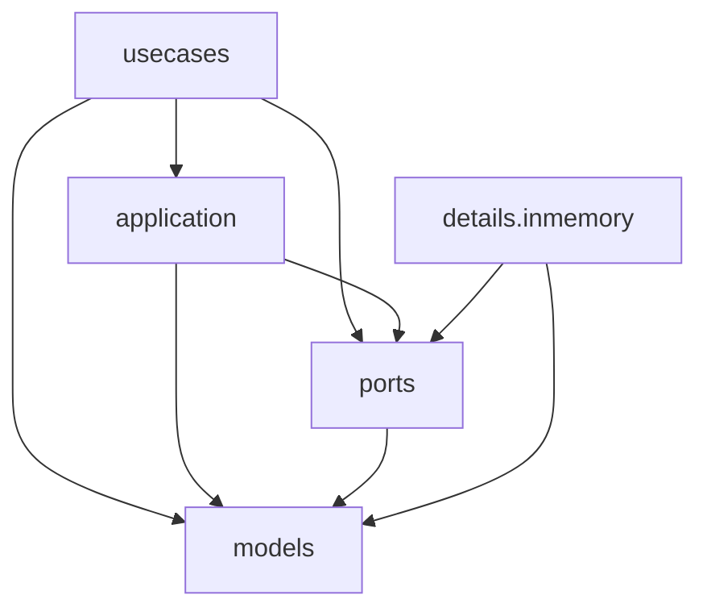

# Certiflow · Decisiones de diseño (Entrega 1)

Módulo de dominio de una plataforma de inspección, habilitación y certificación de activos.
Java 25, Maven, JUnit 5. Sin frameworks: el código es el documento de diseño principal y este
archivo explica por qué tiene la forma que tiene.

```bash
mvn clean test
```

---

## 1. Supuestos de negocio donde el enunciado es ambiguo

| # | Tema | Decisión | Consecuencia |
|---|---|---|---|
| S1 | "Inspección iniciada" | La inspección nace asignada y abierta en un solo paso, y en ese momento captura la `SchemaVersion` vigente, que es inmutable. | Publicar una versión nueva crea otro objeto; la inspección conserva su referencia. Un criterio agregado en v2 lanza `CriterionNotInSchemaException` en una inspección abierta con v1. |
| S2 | Esquema por tipo de activo | Existe un único `InspectionSchema` por `AssetType`, con N versiones guardadas en un `SchemaVersionLog` numerado de forma consecutiva desde 1. `InspectionSchema` es un record inmutable: `withNewVersion(...)` devuelve un esquema nuevo con el log extendido y el anterior queda intacto; el repositorio reemplaza el esquema de ese tipo de activo. Los casos de uso crean esquemas y agregan versiones a través del servicio de dominio `InspectionSchemaService`, que audita ambos hechos (`SchemaAudit.CREATED`, `VERSION_ADDED`) con su autor. | `AssignInspection` busca el esquema por el tipo del activo. Crear un segundo esquema para el mismo tipo falla con `SchemaAlreadyDefinedForAssetTypeException`. |
| S3 | Aprobado, observado, rechazado | La regla solo dice si la respuesta cumple. Si no cumple, la severidad del criterio decide: `MINOR` → `OBSERVED`; `MAJOR` y `CRITICAL` → `REJECTED`. Sin respuesta o sin la evidencia exigida: `PENDING`. | La decisión es un dato de `Severity`, no un condicional repartido por el código. |
| S4 | Hallazgos | Se levantan al cerrar la inspección, uno por criterio observado o rechazado, con la severidad del criterio, la evidencia adjunta y el responsable del activo. `close()` devuelve el evento `InspectionClosed` con las no conformidades, y los hallazgos se generan a partir de él. | `Finding` es un agregado propio cuyo ciclo de vida sobrevive a la inspección. Si alguien cierra sin generar los hallazgos, la elegibilidad lo detecta (S5). |
| S5 | Qué bloquea la certificación | Los hallazgos abiertos cuya severidad lo declara (`Severity.blocksCertification()`): `MAJOR` y `CRITICAL`. Además, toda no conformidad bloqueante de la evaluación vigente de la inspección tiene que tener su hallazgo; si no lo tiene, la decisión de certificación lo informa como `UNADDRESSED_NON_CONFORMITIES` (ver D10). Los `MINOR` se siguen con acciones correctivas pero no impiden certificar. | "Observado" y "rechazado" tienen consecuencias distintas y defendibles. Ni un cierre directo del agregado ni una rectificación que introduce un rechazo dejan certificable la inspección. |
| S6 | Rectificación y hallazgos | Rectificar corrige el acta y su evaluación derivada; no regenera ni elimina hallazgos ya levantados. Si la rectificación introduce una no conformidad bloqueante sin hallazgo, la inspección deja de ser elegible (S5). | Sin efectos en cascada entre agregados. Queda como limitación conocida (ver sección 6). |
| S7 | Revisión original | Cerrar crea la `Revision` 1; cada rectificación agrega otra; ninguna se modifica. | `originalRevision()` devuelve siempre lo que se firmó al cerrar. |
| S8 | Acción correctiva | Vive dentro de su hallazgo. Está cerrada cuando tiene una verificación aceptada; está vencida cuando sigue abierta y la fecha es posterior a `dueDate`. El verificador debe ser distinto del responsable de la acción. Cuando se acepta una acción, el hallazgo cancela sus otras acciones abiertas y registra la `Cancellation` (quién verificó y cuándo). La fecha límite no puede ser anterior al día en que se planifica, y una verificación rechazada tiene que explicar por qué (`VerificationResult.requiresNotes()`). | Una verificación aceptada cierra acción y hallazgo a la vez, sin coordinación externa. Ninguna acción queda huérfana ni figura como vencida en un hallazgo cerrado. El día `dueDate` todavía no está vencida. |
| S9 | Vencimiento del certificado | `ValidityPeriod(validFrom, validUntil)` con ambos extremos incluidos. La vigencia arranca el día de emisión. `EXPIRED` se deriva de la fecha consultada. | Vigente todo el día `validUntil`, vencido el siguiente. No existe un booleano que pueda quedar desactualizado. |
| S10 | Unicidad y suspensión | Un activo tiene a lo sumo un certificado vigente. Un certificado suspendido dentro de su validez sigue ocupando ese lugar. Solo se puede suspender un certificado `ACTIVE` en la fecha de la suspensión: uno vencido, ya suspendido o renovado lanza `CertificateNotActiveException`. | No se puede esquivar una suspensión emitiendo otro certificado; la salida es renovar. |
| S11 | Renovación | Emite un certificado nuevo, basado en una inspección cerrada después que la del certificado actual (7.3) y sujeto a la misma elegibilidad; el anterior pasa a `RENEWED`, estado terminal. No se modela "levantar una suspensión". `Certificate.ensureRenewableWith` se valida antes de pedir el número, así una renovación rechazada no consume numeración. | La historia no se borra. Menos transiciones que probar. La numeración queda correlativa. |
| S12 | Límites numéricos | `Range[minimum, maximum]` cerrado en ambos extremos; un mínimo mayor que el máximo es configuración inválida. La unidad es configuración de la regla, no un dato libre de la respuesta numérica. | La inspección trabaja con el valor en la unidad que define su esquema; no hay conversión de unidades. |
| S13 | Evidencia obligatoria | Un criterio puede exigir una cantidad mínima de evidencias de un tipo concreto: `EvidenceRequirement(kind, minimum)`, a lo sumo un requisito por tipo. Cada evidencia exigida tiene que ser un archivo distinto: adjuntar dos veces la misma referencia al mismo criterio se rechaza (`DuplicateEvidenceException`). | Un criterio respondido pero sin la foto exigida queda `PENDING` y bloquea el cierre. "Dos fotos" no se cumple con la misma foto dos veces, y un criterio con dos requisitos del mismo tipo es un esquema inválido (`InvalidSchemaException`) en lugar de dos requisitos que se cumplen con una sola foto. El mismo archivo sí puede respaldar criterios distintos. |
| S14 | Personas | Inspector, responsable, verificador y emisor son `Person(id, name)`, una entidad identificada por `PersonId` (legajo o documento que asigna la organización) e igual solo por ese id. El rol lo da el campo que la referencia. | La regla "verificador distinto del responsable" compara identidades: dos homónimos son personas distintas y la misma persona se reconoce aunque su nombre se escriba distinto. |
| S15 | Identidad | Todo agregado tiene identidad: `AssetCode` (placa del activo), `CertificateNumber`, `PersonId`, e `InspectionId` y `FindingId` generados por su repositorio (`nextId()`). `CorrectiveActionId` numera las acciones dentro de su hallazgo. Entre agregados se referencia por id, salvo `Asset`, que es un record inmutable y se conserva como objeto. | Los casos de uso reciben y devuelven ids; cargan el agregado con `findById` y lanzan `...NotFoundException` si no existe. Ver D3. |
| S17 | Alcance de la inspección | La asignación fija un `InspectionScope`: `FullScope` (todo el esquema) o `SectionsScope` (secciones nombradas, que deben existir en la versión capturada, o falla con `SectionNotInSchemaException`). La inspección solo tiene respuestas para los criterios de su alcance: responder fuera lanza `CriterionOutOfScopeException`, y cerrar solo exige completar lo que está dentro. Solo una inspección que cubre todo el esquema puede respaldar un certificado (la decisión lo informa como `PARTIAL_INSPECTION`). | Una inspección parcial sirve para seguimiento y genera hallazgos, pero no certifica. El alcance deja de ser un texto libre que no restringía nada. |
| S18 | Características del activo | `Characteristics` es una colección de `Characteristic(name, value)` con nombres únicos (`DuplicateCharacteristicException`) y consulta `valueOf(name)`. | Reemplaza al `Map<String,String>`: los datos del activo se validan y se consultan con el vocabulario del dominio. |
| S19 | Independencia en la asignación | Quien asigna una inspección no puede realizarla (`AssignerCannotInspectException`); el responsable del activo no puede asignar su inspección (`AssetResponsibleCannotAssignInspectionException`) ni inspeccionarlo (`AssetResponsibleCannotInspectOwnAssetException`). Se valida al nacer la inspección. | La inspección la realiza alguien independiente de quien la pide y de quien responde por el activo. |
| S16 | Informes | `InspectionAct`, `FindingsSummary` y `CertificateDocument` son records sin formato. El acta solo se emite para inspecciones cerradas. | Son modelos de lectura: ahí se usan getters a propósito. |

---

## 2. Arquitectura y dirección de dependencias



Cada flecha se lee "importa" y el gráfico muestra todas las dependencias directas. En los tests, el fixture
es la raíz de composición y es el único que conoce todos los paquetes.

| Paquete | Importa |
|---|---|
| `usecases` | `application`, `ports`, `models` |
| `application` | `ports`, `models` |
| `ports` | `models` |
| `models` | nada |
| `details.inmemory` | `ports`, `models` |

Nada importa hacia arriba, y ningún paquete del negocio importa `details`: los detalles implementan los
puertos y el fixture los conecta.

- **`models`**: entidades, value objects, reglas, los decoradores de auditoría y el puerto `AuditLog<S>`. No importa ningún otro paquete ni consulta relojes.
- **`ports`**: lo que el negocio le pide al exterior: los cinco repositorios y `CertificateNumbering`, definidos según lo que los casos de uso necesitan. Solo importa `models`.
- **`usecases`**: un caso de uso por clase, agrupados por concepto (`asset`, `schema`, `inspection`, `finding`, `certificate`, `report`).
- **`application`**: los modelos de lectura de los informes (`application.report`). La elegibilidad y todas las excepciones de negocio viven en `models` (ver D10 y D11).
- **`details.inmemory`**: implementaciones de los puertos.

Los nombres `models`, `usecases`, `ports` y `application` son los que la cátedra propone para un módulo de
negocio, el equivalente al módulo `domain` de DDD: todo el módulo es negocio, sin base de datos, controllers
ni framework. Dentro de `models` y de `usecases` se agrupa por concepto y no por tipo de clase, porque
`Standard...`, `Audited...` y su fábrica comparten visibilidad de paquete (ver D7) y separarlos obligaría a
hacerlos públicos.

**Por qué `AuditLog` no está en `ports`.** Es un puerto, pero quienes lo usan son los decoradores y los
fábricas, que viven en `models`. Mudarlo haría que `models` importe `ports` mientras `ports` ya importa
`models`: un ciclo. Se queda en `models.audit`, al lado del código que lo consume, que es donde la inversión
de dependencias ubica la interfaz.

**Negocio y detalles.** Las reglas de aprobación (`NumericRangeRule`, `YesNoRule`,
`OptionInListRule`), las respuestas y las escalas estándar de severidad y evidencia son negocio aunque se
enchufen detrás de una interfaz. Por eso viven en `models.evaluation`.

Dependencias directas entre los paquetes de `models`, sin ciclos (cada línea se lee "importa"):

```
shared       ->  (nada)
audit        ->  shared
asset        ->  shared
evaluation   ->  shared
schema       ->  shared, asset, evaluation
inspection   ->  shared, asset, evaluation, schema, audit
finding      ->  shared, asset, evaluation, schema, audit, inspection
certificate    ->  shared, asset, audit, inspection
certification  ->  inspection, finding
```

`models` no importa ningún otro paquete, `ports` solo importa `models` y nadie importa `details`. Ambos
grafos se verificaron recorriendo los `import` de todo `src/main`.

**Dónde vive cada validación.** Una regla vive dentro del agregado cuando puede decidirse con su propio
estado y debe cumplirse siempre, sin importar desde qué caso de uso se lo manipule. Por ejemplo, una
`Inspection` no puede cerrarse si tiene criterios pendientes; una `CorrectiveAction` no puede ser
verificada por su responsable; y un `Certificate` no puede renovarse dos veces. Estas reglas se validan
en los métodos del agregado antes de modificarlo.

Las reglas que necesitan consultar o coordinar más de un agregado viven en la capa que los orquesta.
Por ejemplo, para certificar hay que mirar los `Finding` del activo: la regla es de negocio y vive en el
servicio de dominio `CertificationEligibility` (`models.certification`), que recibe la inspección y los
hallazgos ya cargados, y el caso de uso los busca en el repositorio; para impedir dos certificados vigentes se consulta el
repositorio desde `IssueCertificate`; y para garantizar un único esquema por `AssetType`,
`CreateInspectionSchema` consulta el repositorio de esquemas antes de crear uno. Así los agregados no
dependen de repositorios ni conocen el resto del sistema.

**Tiempo.** Los casos de uso leen el `Clock` y le pasan `Instant` o `LocalDate` al dominio. El dominio es
determinista y los tests usan un reloj controlable.

---

## 3. Decisiones principales

### D1. Reglas de aprobación: Strategy con el tipo de respuesta en la firma

- **Dónde:** `ApprovalRule<A extends Answer>`, `NumericRangeRule`, `YesNoRule`, `OptionInListRule`, `Criterion<A>`, `CriterionResponse<A>`, `Inspection.recordAnswer(Criterion<A>, A, ...)`.
- **Por qué:** agregar una regla es agregar una clase; nada más cambia. El contrato LSP es explícito en el tipo: `ApprovalRule<NumericAnswer>` declara qué acepta. Ofrecerle un `YesNoAnswer` a un criterio numérico **no compila**, así que ese error no necesita excepción ni test de ejecución. La unidad pertenece a la regla del criterio y la respuesta solo conserva el valor. `CriterionResponse<A>` lleva consigo su `Criterion<A>`, de modo que evaluar no requiere ningún cast.
- **Alternativas descartadas:**
  - *Double dispatch con métodos `default` que lanzan excepción:* funcionaba, pero la interfaz prometía tres capacidades y cada regla cumplía una. Es la violación de ISP de la clase 2 maquillada.
  - *Visitor con métodos abstractos:* obliga a cada regla a implementar "no soy yo" para los otros tipos.
  - *`instanceof` en la regla:* viola OCP y no es fiel al paradigma.
- **Costo:** comodines (`Criterion<?>`) en `Section` y `SchemaVersion`; `Answer` queda como interfaz sin métodos, cuyo único fin es acotar los genéricos.

### D2. Conjuntos extensibles con interfaz más enum; vocabulario cerrado con enum simple

- **Principio:** OCP aplicado donde el cambio es previsible.
- **Dónde:** `Severity` + `StandardSeverity`; `EvidenceKind` + `StandardEvidenceKind`; `AuditAction` + `InspectionAudit`, `FindingAudit`, `CertificateAudit`.
- **Por qué:** las escalas de severidad y los tipos de evidencia los define cada entidad certificadora, y las acciones de auditoría crecen con cada agregado. Con la interfaz, sumar valores es sumar un enum, sin tocar el existente. Frente a un `record` con constantes, el enum evita crear un tipo nuevo por un error de tipeo.
- **Qué quedó como enum simple y por qué:** `Outcome`, `YesNoAnswer`, `VerificationResult`, `CertificateStatus`. Son vocabulario cerrado por el enunciado; si cambian, cambió el lenguaje del negocio y el dominio debe cambiar. Un punto de extensión ahí sería especulativo.
- **Costo:** quien implemente `Severity` o `EvidenceKind` fuera de un enum debe definir `equals`, porque `Criterion` se usa como clave.

### D3. Agregados con identidad y referencias entre agregados por id

- **Principio:** DDD; un agregado se referencia desde otro por su identidad, no por el objeto.
- **Dónde:** `InspectionId`, `FindingId` y `CorrectiveActionId` (records), además de `AssetCode`, `CertificateNumber` y `PersonId`. `Finding` guarda el `InspectionId` de su inspección; `Certificate` guarda un `InspectionReference(id, closedAt)`, con el instante de cierre que necesita la regla de renovación. `InspectionClosed` lleva el `InspectionId`.
- **Por qué:** con referencias por objeto, un hallazgo o un certificado tenían acceso al agregado vivo de otro, y los casos de uso recibían agregados que quien llamaba podía modificar salteándolos (por ejemplo `inspection.close()` sin levantar hallazgos). Ahora los casos de uso reciben ids, cargan el agregado con `findById` y son el único punto de entrada para modificarlo. Los ids sintéticos los genera el repositorio (`nextId()`), así el dominio no depende de la estrategia de generación y sigue siendo determinista.
- **Excepción:** `Asset` se conserva como objeto dentro de `Inspection`, `Finding` y `Certificate`: es un record inmutable, así que funciona como una foto del activo y no da acceso de escritura. El `AuditLog` sigue indexado por objeto.
- **Costo:** cada caso de uso carga lo que necesita del repositorio y los tests leen el estado con `findById`.

### D4. `CorrectiveAction` dentro del agregado `Finding`

- **Principio:** frontera de consistencia; Tell, Don't Ask.
- **Dónde:** `Finding.planAction`, `Finding.verifyAction`; `CorrectiveAction.verify` es de paquete.
- **Por qué:** verificar con éxito una acción cierra el hallazgo. Si fueran dos agregados, esa reacción la tendría que orquestar un caso de uso. Adentro del mismo agregado es una consecuencia: `Finding.isOpen()` se deriva de sus acciones.
- **Costo:** un hallazgo con muchísimas acciones se carga entero; irrelevante a esta escala.

### D5. Estado derivado en lugar de almacenado

- **Dónde:** `Inspection.isClosed()` = tiene revisiones; `Finding.isOpen()` = ninguna acción verificada con éxito; `CorrectiveAction.isClosed()` e `isOverdueOn(date)`; `Certificate.statusOn(date)`; `Inspection.evaluate()`.
- **Por qué:** lo que no se guarda no puede quedar inconsistente. La evaluación se recalcula siempre desde las respuestas y las reglas, por eso corregir una respuesta cambia el resultado sin pasos extra.
- **Alternativa descartada:** `boolean closed`, `boolean expired`, enums de estado para hallazgos y acciones, resultados guardados junto a respuestas editables.
- **Excepción deliberada:** `CertificateLifecycle` (`ISSUED`, `SUSPENDED`, `RENEWED`) sí se guarda, porque suspender y renovar son decisiones de alguien y no se pueden deducir del calendario.

### D6. Ciclo de vida de la inspección: revisiones y guardas

- **Dónde:** `StandardInspection.revisions`, `ensureOpen()`, `ensureClosed()`, `Revision`.
- **Por qué:** una inspección cerrada es una inspección con al menos una revisión. `Revision` concentra lo que de otro modo serían un estado "cerrado" con datos y un registro de rectificación aparte. El antes y el después de una rectificación se obtienen comparando dos revisiones consecutivas.
- **Alternativa descartada:** patrón State con `Open` y `Closed`. Los dos estados no comparten ninguna operación válida, así que la interfaz común obligaba a implementar métodos que solo lanzan excepción. Ver sección 4.

### D7. Auditoría con Decorator, separando hechos de dominio de bitácora

- **Principios:** SRP, OCP, DIP; patrón Decorator.
- **Dónde:** `AuditedInspection`, `AuditedFinding`, `AuditedCertificate`; `AuditedInspectionFactory`, `AuditedFindingFactory`, `AuditedCertificateFactory`; puerto `AuditLog<S>`; `AuditEntry`; `InMemoryAuditLog<S>`.
- **Por qué:**
  - Los **hechos de dominio** que las reglas y los informes necesitan viven en el agregado: `Revision` (motivo, autor, fecha), `Verification`, `Suspension`, y desde D12 también el autor y la fecha de cada respuesta, evidencia adjunta y acción planificada. Una rectificación no puede ocurrir sin su revisión.
  - La **bitácora** cronológica de quién hizo qué es transversal y vive en los decoradores.
  - El decorador registra después de que la operación fue aceptada: si lanza una excepción, no queda entrada.
  - Las clases `Standard...` y `Audited...` son de paquete. El único punto público donde nace un agregado es su `...Factory` (patrón Factory), que exige el `AuditLog` de su tipo por constructor. No hay forma de obtener una inspección sin auditar, ni armando mal la aplicación.
  - El `AuditLog` se entrega por constructor porque es un colaborador que no cambia entre llamadas; por parámetro van los datos de cada operación.
  - **Un historial por tipo de agregado.** El puerto es `AuditLog<S> { record(S, AuditEntry); historyOf(S) }` y cada agregado auditado tiene el suyo: `AuditLog<Inspection>`, `AuditLog<Finding>` y `AuditLog<Certificate>`. El esquema es inmutable y cambia de objeto con cada versión, así que su historial se indexa por su identidad de negocio: `AuditLog<AssetType>`, alimentado por `InspectionSchemaService`. `InMemoryAuditLog` compara claves con `equals`. `AuditEntry` no sabe de qué objeto habla, porque el sujeto es la clave del historial.
  - La renovación nace del certificado y no de la fábrica. Por eso `AuditedCertificate.renew` decora el certificado nuevo y registra su emisión él mismo, sin guardar una referencia a su fábrica. El costo son dos líneas repetidas respecto de `AuditedCertificateFactory.create`; la alternativa era una dependencia del decorador hacia quien lo crea.
- **Alternativas descartadas:**
  - *Auditoría dentro del agregado* (`audit.record(...)` en cada método): más barata, y defendible porque la auditoría es requisito de negocio, pero mezcla dos niveles de abstracción en cada operación.
  - *Decorar casos de uso:* exige una interfaz genérica común a los 17 casos de uso y audita con la granularidad equivocada, porque `CloseInspection` produce dos hechos distintos.
  - *Método estático de creación en la interfaz:* hacía que la abstracción conociera a sus implementaciones y obligaba a los casos de uso a transportar el servicio de auditoría.
  - *Bitácora global con `AuditEntry(Object subject, ...)` y `entriesFor(Object)`:* era la versión anterior. Compilaba `entriesFor(asset)` y devolvía una lista vacía sin aviso, y el tipo no decía qué se podía auditar. Además, `AuditTrail` solo existía para armar la entrada con ese `Object`, y desapareció junto con él. Lo que se pierde es la vista cronológica única de todo el sistema, que ningún caso de uso ni informe consultaba: el enunciado pide el historial de cada objeto.
  - *Interfaz marcadora `Auditable`* (vacía, implementada por `Inspection`, `Finding` y `Certificate`) en lugar de `Object`: resolvía el tipo, pero agregaba una interfaz sin métodos cuyo único propósito era tapar el `Object`. Con el sujeto como parámetro genérico del puerto no hace falta ninguna marca.
- **Costo:** diez clases más que la versión interna: tres interfaces, tres decoradores, tres fábricas e `InMemoryAuditLog`. Reenvío manual de las consultas en cada decorador.

### D8. Política de condicionales

- **Regla:** polimorfismo cuando la variación es por tipo y se espera que crezca; `if` común cuando es una decisión de negocio puntual que no va a crecer. No se busca "cero `if`" como fin en sí mismo: un condicional disfrazado (una tabla `Map` que hace de `switch`, un enum que solo existe para esquivar un `if`) es menos legible que el condicional.
- **Polimorfismo o enums con comportamiento:** reglas de aprobación (D1), `Severity`, `Outcome.raisesFinding`, `CertificateLifecycle.statusOn`, `InspectionScope`, estado derivado (D5). Cada `VerificationResult` conoce su propia `FindingAudit` (`result.audit()`), en lugar de una tabla `Map<VerificationResult, FindingAudit>` en el decorador.
- **`if` común:** las cláusulas de guarda que lanzan una excepción (por ejemplo `StandardCertificate.suspend` exige que el certificado esté `ACTIVE`) y decisiones puntuales como "si la verificación fue aceptada, cancelar las demás acciones" (`StandardFinding.verifyAction`).
- **`Optional`** se usa solo donde la ausencia es un resultado legítimo: `CriterionResponse.answer()`, la cancelación de una acción y las búsquedas de repositorio. No se usa como control de flujo.

### D9. Puertos segregados

- **Principios:** ISP, DIP.
- **Dónde:** `AssetRepository {save, findByCode}`, `InspectionSchemaRepository {save, findByAssetType}`, `InspectionRepository {nextId, save, findById}`, `FindingRepository {nextId, save, saveAll, findById, findByAsset}`, `CertificateRepository {save, findByNumber, findCurrentFor}`, `CertificateNumbering {next}`, `AuditLog<S> {record, historyOf}`. Los seis primeros viven en `ports`; `AuditLog` vive en `models.audit` por el motivo explicado en la sección 2.
- **Por qué:** cada interfaz tiene lo que sus casos de uso usan. La única consulta con lógica, `findCurrentFor`, delega la decisión en `Certificate.isCurrentOn(date)`.

### D10. Elegibilidad para certificar como política intercambiable

- **Principio:** OCP; patrón Strategy; servicio de dominio.
- **Dónde:** `models.certification`: interfaz `CertificationEligibility` e implementación `NoBlockingFindingsEligibility`, usadas por `IssueCertificate`, `RenewCertificate` y `EvaluateCertification`.
- **Decisión explicable:** `evaluate(inspection, assetFindings)` no lanza excepciones: devuelve un `CertificationDecision` con todas las `Ineligibility(reason, detail)` que encuentra (`INSPECTION_NOT_CLOSED`, `PARTIAL_INSPECTION`, `UNADDRESSED_NON_CONFORMITIES`, `BLOCKING_FINDINGS`). `EvaluateCertification` la expone tal cual; `IssueCertificate` y `RenewCertificate` la consultan y, si no es elegible, lanzan `NotEligibleForCertificationException`, que lleva la decisión completa.
- **Por qué es de dominio:** "no certificar con hallazgos bloqueantes" es una regla del negocio. El servicio no depende de repositorios: el caso de uso le entrega los hallazgos del activo.
- **Por qué:** a diferencia de las fábricas, acá sí hay una segunda política identificada. El equipo discutió y descartó "cualquier hallazgo abierto impide certificar" (ver S5); otra entidad certificadora podría elegirla. Cambiar de política es escribir otra implementación y entregarla al armar la aplicación, sin tocar los casos de uso.
- **Costo:** una interfaz con una sola implementación hoy. Se acepta porque el eje de variación es concreto y ya tiene un segundo candidato, que es el criterio que este documento exige para cada abstracción.

### D11. Errores explícitos

- Reglas de negocio: excepciones con nombre del dominio que extienden `DomainException` (`InspectionAlreadyClosedException`, `CriterionNotInSchemaException`, `VerifierMustDifferFromResponsibleException`, `NotEligibleForCertificationException`, `AssetAlreadyCertifiedException`, entre otras).
- Toda regla del dominio lanza una `DomainException`, sin excepciones genéricas de Java. Un texto obligatorio vacío (nombre, código, descripción, motivo, referencia) lanza `RequiredValueMissingException` (`models.shared`), una sola clase porque es la misma regla en todos los casos.
- Los constructores validan reglas de dominio, no la forma del dato. `null` nunca es un valor válido en este código y por eso no se chequea: que un dato llegue nulo es un problema de entrada, y cuando exista una API lo validará el adaptador.
- Las excepciones de dominio viven en un subpaquete `exceptions` dentro del paquete de su concepto (`models.inspection.exceptions`, `models.finding.exceptions`, `models.certificate.exceptions`, `models.schema.exceptions`). La de `models.evaluation` queda junto a la clase que la lanza. También las de reglas que cruzan agregados (`AssetAlreadyCertifiedException`, `SchemaAlreadyDefinedForAssetTypeException`, `AssetAlreadyRegisteredException`) y las de ids inexistentes (`...NotFoundException`) viven en el paquete de su concepto, en `models`.
- Las operaciones validan antes de mutar. El test `rectificationWithoutReasonIsRejectedAndChangesNothing` lo comprueba.

### D12. Quién y cuándo como hechos de dominio

- **Dónde:** `GivenAnswer(value, answeredBy, answeredAt)`, `AttachedEvidence(evidence, attachedBy, attachedAt)`, `CorrectiveAction.plannedBy()` y `plannedAt()`; `CriterionResponse` guarda `given` y `attachments`.
- **Por qué:** registrar una respuesta, adjuntar evidencia y planificar una acción recibían quién y cuándo, pero el núcleo los descartaba y solo el decorador los usaba para la bitácora. Observaciones, revisiones, verificaciones y suspensiones ya guardaban su autor y su fecha, así que era una inconsistencia. Ahora el dato vive en el agregado: corregir una respuesta produce un `GivenAnswer` nuevo, y el acta muestra quién respondió cada criterio sin consultar la auditoría.
- **Alternativa descartada:** exponer además `answer()` y `evidence()` públicos. Evitaba tocar `Finding` y el acta, pero ofrecía dos formas de pedir lo mismo y dejaba el dato nuevo sin ningún consumidor en producción.
- **Costo:** dos records más; autor y fecha quedan tanto en el dominio como en la bitácora, igual que ya ocurría con las revisiones.

### D13. Vista de solo lectura de la inspección

- **Principio:** ISP.
- **Dónde:** `InspectionView` declara las consultas; `Inspection` la extiende y agrega los cinco comandos. `Certificate` recibe un `InspectionView` para validar su base (cerrada, del mismo activo, posterior al certificado que renueva) y guarda solo su referencia.
- **Por qué:** quien solo necesita leer la inspección no debería poder modificarla. Desde D3 los otros agregados guardan el id, y el `InspectionView` solo se usa como parámetro de lectura.
- **Costo:** una interfaz más. La protección es de compilación: un cast la saltearía, y los casts no se usan en este código. Los casos de uso de certificación y el acta siguen recibiendo `Inspection` aunque solo leen.

---

## 4. Patrones que se decidió no aplicar

| Patrón | Por qué no | Consecuencia |
|---|---|---|
| **State** para la inspección | Abierta y cerrada no comparten operaciones válidas; la interfaz común forzaba métodos que solo lanzan excepción. Con guardas permitidas y el estado derivado de las revisiones, eran dos clases de estructura sin comportamiento. | Si aparecen más estados con comportamiento compartido (por ejemplo "en revisión"), habría que reconsiderarlo. |
| **Factory con selección** (clase 2, `applyFor`) | Resuelve elegir en ejecución entre implementaciones. Acá no hay nada que elegir: hay una sola clase de inspección y la selección regla-respuesta la resolvieron los genéricos. | Sí se aplica Factory como punto único de creación: los `...Factory` encapsulan cómo se compone el agregado (`Standard...` envuelto en `Audited...`) y registran su nacimiento. Son clases concretas; si aparece una segunda forma de crear agregados se extrae la interfaz en ese momento, como ocurrió en la clase con `CallCostCalculatorFactory`. |
| **Event Sourcing / eventos de dominio** | La bitácora por decorador alcanza y la única reacción entre agregados desapareció al mover `CorrectiveAction` dentro de `Finding`. | No se puede reconstruir el estado desde el historial. |
| **Herencia para tipos de activo o de evidencia** | El tipo es un dato. | `AssetType` es un value object; `EvidenceKind` un enum extensible. |
---

## 5. Riesgo de negocio → test que lo cubre

| Riesgo | Test |
|---|---|
| Una versión nueva del esquema altera una inspección en curso | `SchemaVersioningTest.newSchemaVersionDoesNotAffectAnInspectionAlreadyStarted` |
| Las inspecciones nuevas no toman la última versión | `SchemaVersioningTest.inspectionsAssignedAfterPublishingUseTheNewVersion` |
| Se cierra con criterios sin responder | `InspectionExecutionTest.inspectionCannotBeClosedWhileCriteriaRemainUnanswered` |
| Se cierra sin la evidencia obligatoria | `InspectionExecutionTest.answeredCriterionStaysPendingUntilItsRequiredEvidenceIsAttached` |
| La misma evidencia adjunta dos veces cuenta como dos | `InspectionExecutionTest.sameEvidenceCannotBeAttachedTwiceToTheSameCriterion` |
| Dos requisitos del mismo tipo se cumplen con una sola evidencia | `CriterionTest.criterionCannotRequireTheSameEvidenceKindTwice` |
| Corregir una respuesta no cambia la evaluación o no deja rastro | `InspectionExecutionTest.correctingAnAnswerBeforeClosingChangesTheEvaluationAndIsAudited` |
| Una inspección cerrada acepta cambios directos | `InspectionExecutionTest.closedInspectionRejectsNewAnswersEvidenceAndObservations` |
| Una operación rechazada deja igual una entrada de auditoría | `InspectionExecutionTest.closedInspectionRejectsNewAnswersEvidenceAndObservations` |
| Hallazgos con severidad, evidencia o responsable incorrectos | `FindingsTest.closingRaisesOneFindingPerNonConformityWithItsSeverityEvidenceAndAssetResponsible` |
| Acción vencida un día antes o un día después | `CorrectiveActionTest.actionIsNotOverdueOnItsDueDateButIsTheDayAfter` |
| Una verificación rechazada cierra algo | `CorrectiveActionTest.rejectedVerificationKeepsActionAndFindingOpenAndIsAudited` |
| Un hallazgo cerrado deja acciones huérfanas que siguen figurando como vencidas | `CorrectiveActionTest.acceptingAnActionCancelsTheOtherOpenActionsOfTheFindingSoNoneIsLeftOverdue`, `rejectedVerificationCancelsNothing` |
| Un dato obligatorio vacío escapa como error genérico de Java | `RequiredValueTest` |
| Dos homónimos se consideran la misma persona | `PersonTest`, `CorrectiveActionTest.namesakeOfTheResponsibleCanVerifyButTheResponsibleUnderAnotherSpellingCannot` |
| El alcance de una inspección no restringe qué se inspecciona, o una inspección parcial certifica | `InspectionScopeTest` |
| Características del activo duplicadas o vacías | `CharacteristicsTest` |
| Publicar una versión modifica el esquema existente, o el log de versiones tiene huecos | `SchemaVersioningTest.publishingAVersionYieldsANewSchemaAndLeavesThePreviousOneUntouched`, `SchemaVersionLogTest` |
| Ids repetidos, referencias por objeto entre agregados o ids inexistentes | `AggregateIdentityTest` |
| Quien asigna o el responsable del activo realizan la inspección | `InspectionAssignmentTest` |
| La creación de un esquema o de una versión no queda auditada | `SchemaVersioningTest.creatingTheSchemaAndAddingVersionsIsAudited` |
| El responsable de la acción se verifica a sí mismo | `CorrectiveActionTest.whoeverIsResponsibleForTheActionCannotVerifyIt` |
| Se certifica con un hallazgo bloqueante abierto | `CertificationTest.assetWithAnOpenBlockingFindingIsNotEligible` |
| Se cierra la inspección sin levantar sus hallazgos y se certifica | `CertificationTest.inspectionClosedWithoutRaisingItsFindingsIsNotEligible` |
| Una rectificación deja certificable una inspección con un criterio rechazado | `CertificationTest.rectificationThatIntroducesABlockingNonConformityRemovesEligibility` |
| La elegibilidad no explica por qué no se puede certificar | `CertificationDecisionTest` |
| Un hallazgo menor impide certificar | `CertificationTest.openMinorFindingsDoNotPreventCertification` |
| No se puede certificar después de corregir | `CertificationTest.assetBecomesEligibleOnceItsBlockingFindingIsClosed` |
| Se certifica sobre una inspección sin cerrar | `CertificationTest.inspectionStillInProgressCannotBackACertificate` |
| Dos certificados vigentes para el mismo activo | `CertificationTest.assetHoldsASingleCurrentCertificate` |
| Se esquiva una suspensión emitiendo otro certificado | `CertificationTest.suspendedCertificateStillOccupiesTheAssetSoANewOneCannotBeIssuedAroundIt` |
| Vence un día antes o un día después | `CertificationTest.certificateIsActiveThroughItsLastDayAndExpiredTheDayAfter` |
| Suspender dos veces, o sin motivo registrado | `CertificationTest.suspensionIsRecordedWithItsReasonAndCannotBeRepeated` |
| Suspender un certificado vencido | `CertificationTest.expiredCertificateCannotBeSuspended` |
| Renovar con la misma inspección o con una anterior | `CertificationTest.renewalRequiresAnInspectionClosedAfterTheOneBehindTheCurrentCertificate` |
| Una renovación rechazada deja un hueco en la numeración | `CertificationTest.failedRenewalDoesNotConsumeACertificateNumber` |
| Una verificación rechazada sin motivo | `CorrectiveActionTest.rejectedVerificationMustExplainWhyAndIsNotRecordedOtherwise` |
| Una acción que nace vencida | `CorrectiveActionTest.actionCanBeDueTodayButNotBeforeItIsPlanned` |
| Renovar pierde el certificado anterior o se saltea la elegibilidad | `CertificationTest.renewalIssuesANewCertificateAndRetiresThePreviousOne`, `renewalIsSubjectToTheSameEligibilityAsIssuance` |
| La rectificación pierde la revisión original o no queda auditada | `RectificationTest.rectificationPreservesTheOriginalRevisionAndIsAudited` |
| Una rectificación inválida modifica el acta | `RectificationTest.rectificationWithoutReasonIsRejectedAndChangesNothing` |
| Una rectificación altera hallazgos ya levantados | `RectificationTest.rectificationLeavesFindingsAlreadyRaisedUntouched` |
| Los informes no reflejan el estado real | `EndToEndFlowTest.assetGoesFromInspectionToCertificateAndEveryReportTellsTheSameStory` |
| Límites del rango mal interpretados | `NumericRangeRuleTest.rangeLimitsAreInclusiveAndAnythingBeyondThemFails` |
| Regla numérica mal configurada | `NumericRangeRuleTest.rangeWhoseMinimumExceedsItsMaximumIsAnInvalidConfiguration`, `OptionInListRuleTest.ruleWithoutAcceptedOptionsIsAnInvalidConfiguration` |
| Tipo de respuesta incorrecto para un criterio | No compila: `ApprovalRule<A>` y `recordAnswer(Criterion<A>, A, ...)`. Ver D1. |
| Pedir el historial de algo que no es el agregado auditado | No compila: `AuditLog<Inspection>.historyOf(...)` solo acepta una inspección. Ver D7. |
| Se pierde quién registró una respuesta, adjuntó una evidencia o planificó una acción | `InspectionExecutionTest.answersAndEvidenceRememberWhoGaveThemAndWhen`, `CorrectiveActionTest.actionRemembersWhoPlannedItAndWhen` |
| Extender severidades o tipos de evidencia obliga a tocar el dominio | `CriterionTest.customSeverityScaleIsHonouredWithoutChangingTheDomain`, `EvidenceRequirementTest.schemaDefinedEvidenceKindsWorkWithoutTouchingTheStandardOnes` |

Los tests de integración usan los repositorios en memoria reales, sin mocks, y un `MutableClock`.
`CertiflowFixture` es la raíz de composición compartida. Total: 107 tests.

---

## 6. Limitaciones conocidas y concesiones

- **Garantía de auditoría.** Está dada por la API (la fábrica exige un `AuditLog`), no por la operación misma. Un `AuditLog` que descarte entradas la anula.
- **Unicidad con concurrencia.** `RegisterAsset` y `CreateInspectionSchema` consultan el repositorio antes de guardar. Es correcto con un solo hilo; con escrituras concurrentes hace falta además una restricción de unicidad en la persistencia (índice único por `AssetCode` y por `AssetType`).
- **Sin vista cronológica global.** Cada tipo de agregado tiene su propio historial (D7). Una consulta del estilo "todo lo que pasó el martes" exigiría recorrer los tres historiales o sumar un puerto de lectura global cuando algún caso de uso lo pida.
- **Rectificación.** No revisa hallazgos ya levantados (S6). Si una rectificación demuestra que un hallazgo bloqueante era un error de carga, igual hay que cerrarlo por su flujo de acción correctiva.
- **Suspensión.** No se puede levantar; la salida es renovar (S11).
