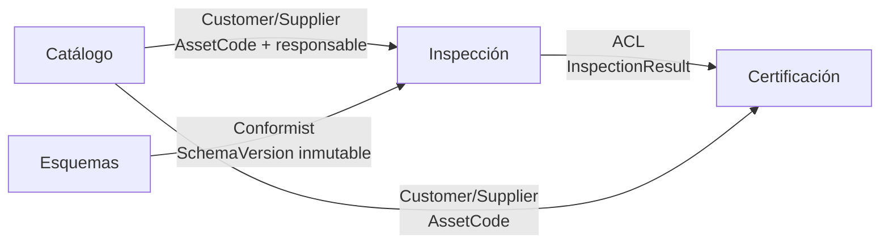
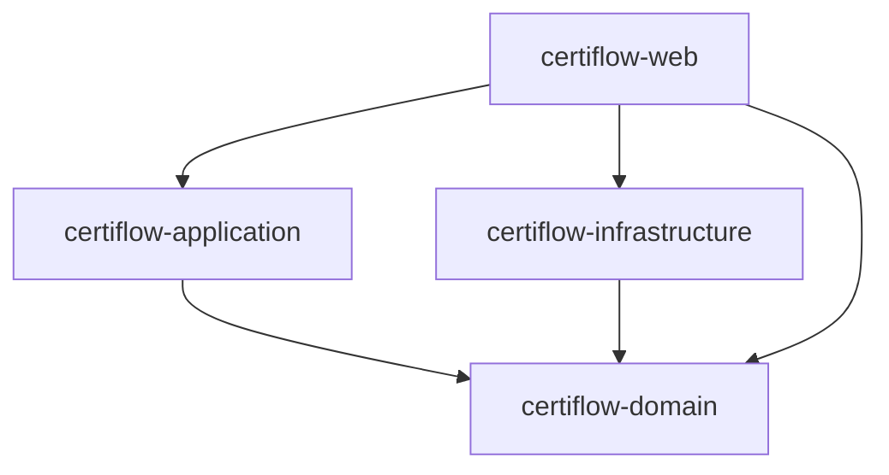

# Spec · Fase 1 · DDD, persistencia, API REST y CI

Fecha: 2026-10-12 · Rama: `entrega-2` · Consigna: [docs/consigna/certiflow-entrega-2.md](../consigna/certiflow-entrega-2.md)

## 1. Objetivo

Dejar la base sobre la que F1, F2 y F3 se agregan sin reestructurar nada: arquitectura DDD explícita (estratégica
y táctica), persistencia real, API REST y CI. **Esta fase no agrega funcionalidad de negocio**: todo lo que hoy
hace el dominio lo sigue haciendo igual, y los 116 tests actuales siguen pasando (adaptados a los nuevos nombres).

### Criterios de aceptación

1. El build tiene cuatro módulos, `certiflow-domain`, `certiflow-application`, `certiflow-infrastructure` y
   `certiflow-web`, y el compilador impide las dependencias prohibidas (§3).
2. Dentro de cada módulo el código se organiza por bounded context (§2).
3. Los casos de uso reciben un `Command` con ids, códigos y valores, nunca objetos de dominio que el cliente no
   puede construir (`Criterion`, `Asset`, `Section`).
4. Ningún archivo de `certiflow-domain` ni de `certiflow-application` importa Spring, JPA ni Jackson.
5. Los cinco agregados se guardan en una base relacional con JPA y se reconstruyen sin repetir validaciones de
   creación ni auditoría (§5).
6. La auditoría se indexa por la identidad del agregado y sobrevive a la reconstrucción desde la base.
7. Cada caso de uso tiene su endpoint REST (§6) y los errores de dominio se traducen a códigos HTTP (§6.3).
8. Hay tests unitarios, parametrizados, de repositorio (sobre H2 real) y de API (sobre la app completa), y CI los
   ejecuta en cada pull request (§7, §8).
9. La app corre contra PostgreSQL con `docker compose up` + `mvn -pl certiflow-web spring-boot:run`.

### Fuera de alcance

- F1, F2 y F3 (cada una tiene su spec, sobre esta base).
- Frontend (se hace cuando la API y F1 a F3 estén terminadas).
- Autenticación. La persona que actúa viaja en el request (§6.2).

---

## 2. DDD estratégico

### 2.1 Bounded contexts

| Contexto | Paquete | Lenguaje | Agregados y conceptos |
|---|---|---|---|
| **Catálogo** | `catalog` | activo, placa, tipo, ubicación, responsable, característica | `Asset`, `AssetCode`, `AssetType`, `Location`, `Characteristics` |
| **Esquemas** | `schema` | esquema, versión, sección, criterio, regla de aprobación, severidad, evidencia exigida | `InspectionSchema`, `SchemaVersion`, `Section`, `Criterion`, reglas, `Severity`, `EvidenceKind` |
| **Inspección** | `inspection` | inspección, alcance, respuesta, evidencia, observación, revisión, rectificación, hallazgo, acción correctiva, verificación | `Inspection`, `Evaluation`, `Revisions`, `Finding`, `CorrectiveActions` |
| **Certificación** | `certification` | certificado, vigencia, suspensión, renovación, elegibilidad, resultado de inspección | `Certificate`, `CertificationEligibility`, `CertificationDecision`, `InspectionResult` |
| *Shared kernel* | `shared` | persona, auditoría | `Person`, `PersonId`, `DomainException`, `RequiredValueMissingException`, `AuditTrail`, `AuditEntry`, `AuditAction`, `AuditLog` |

Hallazgos y acciones correctivas quedan en **Inspección**: nacen del cierre y de la rectificación (S4, S6) y
comparten el lenguaje de la no conformidad. Separarlos en otro contexto obligaría a un evento entre contextos
para algo que hoy es una consecuencia directa del cierre.

Los informes (`InspectionAct`, `FindingsSummary`, `CertificateDocument`) son modelos de lectura del contexto que
los produce: acta y resumen en Inspección, documento del certificado en Certificación.

### 2.2 Context map



| Relación | Tipo | Cómo se implementa |
|---|---|---|
| Esquemas → Inspección | **Conformist** | La inspección captura la `SchemaVersion` vigente y la usa tal cual (S1). Ya es así. |
| Catálogo → Inspección | **Customer/Supplier** | La inspección guarda `AssetCode` y una foto del responsable (D3). Ya es así. |
| Catálogo → Certificación | **Customer/Supplier** | El certificado guarda `AssetCode`. Ya es así. |
| Inspección → Certificación | **Anticorruption Layer** | **Cambio.** Certificación deja de importar `Finding` e `InspectionView`. Decide sobre su propio `InspectionResult`, que arma un traductor. |

### 2.3 ACL entre Inspección y Certificación

Hoy `NoBlockingFindingsEligibility.evaluate(InspectionView, List<Finding>)` y `Certificate` dependen del modelo de
Inspección. Pasa a ser así:

- `certification.model.InspectionResult` (record): `InspectionReference inspection` (id e instante de cierre),
  `AssetCode assetCode`, `boolean closed`, `boolean coversWholeSchema`, `List<OpenNonConformity> openNonConformities`.
- `certification.model.OpenNonConformity` (record): `String criterionCode`, `Severity severity`. `Severity`
  pertenece a Esquemas y Certificación la usa por *Conformist*, igual que Inspección.
- `certification.model.InspectionResultTranslator` (interfaz, puerto del ACL): `InspectionResult translate(InspectionId id)`.
- `application.certification.InspectionResultTranslatorImpl`: carga la inspección y los hallazgos del activo desde
  sus repositorios y arma el `InspectionResult`. Es el único lugar que conoce los dos modelos.
- `CertificationEligibility.evaluate(InspectionResult)`; `Certificate` recibe `InspectionResult` en lugar de
  `InspectionView` para validar su base (cerrada, mismo activo, posterior al certificado que renueva).

Con esto F1 agrega resultados por subsistema al `InspectionResult` y F3 son políticas que deciden sobre él, sin
tocar Inspección.

### 2.4 Lenguaje ubicuo

DESIGN.md gana una sección **Glosario** con cada término del §2.1, su definición de negocio y la clase que lo
representa. Los nombres de clases, métodos y endpoints usan esos términos.

---

## 3. Módulos y capas (DDD táctico)

Siguen el diagrama DDD de la Clase 7 ([docs/clases/clase-7-arquitecturas.md](../clases/clase-7-arquitecturas.md)):
`domain` con las interfaces `UseCase` y `Repository`, `application` con `UseCaseImpl`, `web` con los
controladores, e `infrastructure` con `RepositoryImpl`.



| Módulo | Paquetes (por contexto `<ctx>`) | Contiene | Depende de |
|---|---|---|---|
| `certiflow-domain` | `<ctx>.model` | agregados, entidades, VOs, eventos, servicios de dominio, fábricas, snapshots, excepciones (`<ctx>.model.exceptions`) | nada |
| | `<ctx>.repository` | interfaces de repositorio y `CertificateNumbering` | `model` |
| | `<ctx>.usecase` | una interfaz por caso de uso, su `XxxCommand` («input») y su respuesta («output») | `model` |
| `certiflow-application` | `<ctx>` | `XxxUseCaseImpl implements XxxUseCase`, el traductor del ACL | `domain` |
| `certiflow-infrastructure` | `<ctx>.persistence` | entidades JPA, interfaces Spring Data, adaptadores `JpaXxxRepository implements XxxRepository`, mappers, convertidores JSON | `domain`, Spring Data JPA, Jackson |
| | `shared.audit` | `JpaAuditLog` | |
| | `inmemory` | los repositorios en memoria actuales, para los tests de `application` | |
| `certiflow-web` | `<ctx>` | controladores REST, DTOs de request y response | `domain`, `application`, `infrastructure`, Spring Web |
| | `config` | `CertiflowApplication` (`@SpringBootApplication`), `UseCaseConfiguration` (`@Bean` por caso de uso), `ApiExceptionHandler` | |

`application` no conoce Spring: los `UseCaseImpl` se instancian como `@Bean` en `certiflow-web`
(`UseCaseConfiguration`), que es la raíz de composición. `infrastructure` sí usa Spring, porque es detalle.

### 3.1 Renombres

| Hoy | Pasa a |
|---|---|
| `ar.edu.itba.certiflow.models.{asset}` | `ar.edu.itba.certiflow.catalog.model` |
| `models.{schema, evaluation}` | `schema.model` |
| `models.{inspection, finding}` | `inspection.model` |
| `models.{certificate, certification}` | `certification.model` |
| `models.{shared, audit}` | `shared.model` |
| `ports.XxxRepository` | `<ctx>.repository.XxxRepository` |
| `usecases.<concepto>.Xxx` | `<ctx>.usecase.XxxUseCase` |
| `application.<concepto>.XxxInteractor` | `application.<ctx>.XxxUseCaseImpl` |
| módulo `certiflow-details`, `details.inmemory` | módulo `certiflow-infrastructure`, `inmemory` |

### 3.2 Forma de un caso de uso

```java
public interface RecordAnswerUseCase {
    void execute(RecordAnswerCommand command);
}

public record RecordAnswerCommand(InspectionId inspectionId, String criterionCode, RawAnswer answer, Person answeredBy) { }
```

El `Command` lleva tipos de dominio simples (ids, `Person`, `LocalDate`, value objects sin reglas de esquema),
pero nunca un objeto que el cliente tendría que sacar de otro agregado. Los casos de uso que hoy devuelven un id o
un informe siguen devolviéndolo.

---

## 4. Cambios en el dominio para soportar API y persistencia

### 4.1 Criterio por código y respuesta tipada (preserva D1)

Hoy `RecordAnswer` y `RectifyInspection` reciben `Criterion<A>` y `A`. Por la API llegan un código y un valor JSON.

- `SchemaVersion.criterion(String code)`: devuelve `Criterion<?>` o lanza `CriterionNotInSchemaException`.
- `RawAnswer` (sealed interface en `schema.model`): `RawNumber(BigDecimal value)`, `RawYesNo(boolean value)`,
  `RawOption(String value)`. Es el valor tal como llega, sin tipo de criterio.
- `ApprovalRule<A>` agrega `A answerFrom(RawAnswer raw)`. Cada regla sabe qué respuesta acepta: `NumericRangeRule`
  solo acepta `RawNumber`; cualquier otra lanza `AnswerTypeMismatchException` (nueva `DomainException`).
- `Criterion<A>.answerFrom(RawAnswer)` delega en su regla y devuelve `A`. `InspectionService` gana
  `recordAnswer(Inspection, String criterionCode, RawAnswer, Person, Instant)`, que busca el criterio en la versión
  de la inspección, obtiene la `A` tipada y llama al comando genérico actual.

La garantía de D1 se mantiene **dentro** del dominio: `Inspection.recordAnswer(Criterion<A>, A, …)` sigue siendo
el único camino y sigue sin compilar con un tipo incorrecto. La conversión desde lo que manda el cliente es un
solo punto, con su excepción y su test.

### 4.2 Auditoría indexada por id

`AuditLog<S>` pasa a indexarse por identidad: `AuditLog<InspectionId>`, `AuditLog<FindingId>`,
`AuditLog<CertificateNumber>`, `AuditLog<AssetCode>` y `AuditLog<AssetType>`. Los servicios de dominio vuelcan con
`auditLog.recordAll(aggregate.id(), aggregate.pullAuditEntries())`. Elimina la limitación "AuditLog indexado por
objeto" de DESIGN.md §6.

### 4.3 Reconstrucción: snapshots (Memento)

`Inspection`, `Finding` y `Certificate` son clases con estado privado y constructores que validan reglas de
creación y anotan `ASSIGNED`, `RAISED` o `ISSUED`. Un repositorio no puede usar esos constructores para leer.

| Agregado | Snapshot (record público en `<ctx>.model`) | Reconstrucción |
|---|---|---|
| `Inspection` | `InspectionSnapshot(id, assetCode, assetResponsible, assignment, schemaVersion, responses, revisions)` | `InspectionFactory.restore(snapshot)` |
| `Finding` | `FindingSnapshot(id, inspectionId, assetCode, criterion, evidence, responsible, actions)` | `FindingFactory.restore(snapshot)` |
| `Certificate` | `CertificateSnapshot(number, assetCode, basedOn, validity, issuedBy, issuedAt, suspensions, lifecycle)` | `CertificateFactory.restore(snapshot)` |
| `Asset`, `InspectionSchema` | no hace falta: ya son records inmutables | constructor del record |

- `snapshot()` es público y devuelve solo datos inmutables.
- `restore(...)` usa un constructor de paquete distinto al de creación: no valida reglas de nacimiento ni anota
  auditoría. Restaurar y volver a tomar el snapshot da un snapshot igual (test).
- Los comandos siguen siendo de paquete (D14): `restore` no abre ningún camino nuevo para modificar el agregado.
- `CorrectiveActions` y `CorrectiveAction` ganan sus constructores de restauración de paquete.

### 4.4 Persona que actúa

Sin cambios en el dominio: `Person(PersonId, name)`. En la API viaja en los headers `X-Person-Id` y
`X-Person-Name` (§6.2).

### 4.5 Consultas

La consigna pide "alta y consulta" de activos y la API necesita leer lo que escribe. Casos de uso de lectura
nuevos, que devuelven modelos de lectura (records) y no agregados:

| Caso de uso | Devuelve |
|---|---|
| `FindAssetUseCase(AssetCode)` | `AssetView` |
| `ListAssetsUseCase(AssetType opcional)` | `List<AssetView>` |
| `FindSchemaUseCase(AssetType)` | `SchemaView` (versiones con sus secciones y criterios) |
| `FindInspectionUseCase(InspectionId)` | `InspectionDetails` (alcance, versión, respuestas con su resultado, revisiones) |
| `AuditHistoryUseCase(tipo, id)` | `List<AuditEntry>` |

Hallazgos por activo y certificado por número no suman casos de uso: ya los devuelven `GenerateFindingsSummary` y
`GenerateCertificateDocument`.

Los repositorios ganan solo las consultas que estos casos de uso usan (`AssetRepository.findAll(Optional<AssetType>)`),
para mantener D9 (puertos segregados).

---

## 5. Persistencia

### 5.1 Tecnología

- Spring Data JPA (Hibernate) en `certiflow-infrastructure`.
- **PostgreSQL** al correr la app (`docker-compose.yml` en la raíz); **H2 en modo PostgreSQL** en los tests.
- Esquema SQL con **Flyway** (`certiflow-infrastructure/src/main/resources/db/migration/V1__init.sql`), el mismo
  en las dos bases. `spring.jpa.hibernate.ddl-auto=validate`.

### 5.2 Mapeo

Las entidades JPA están en `<ctx>.persistence` y **no** son las del dominio. Cada adaptador traduce con un mapper:

```
save:  agregado → snapshot() → XxxMapper → XxxEntity → JpaRepository.save
find:  JpaRepository.findBy… → XxxEntity → XxxMapper → snapshot → XxxFactory.restore → agregado
```

| Tabla | Origen | Notas |
|---|---|---|
| `asset`, `asset_characteristic` | `Asset` | PK `code` |
| `inspection_schema`, `schema_version` | `InspectionSchema`, `SchemaVersion` | PK de esquema `asset_type`; `schema_version.sections` es **JSON en `TEXT`** |
| `inspection`, `criterion_response`, `attached_evidence`, `observation`, `revision` | `Inspection` | `inspection.schema_version_id` → `schema_version` |
| `finding`, `corrective_action` | `Finding` | índice por `asset_code` |
| `certificate`, `suspension` | `Certificate` | índice por `asset_code`; `lifecycle` como texto |
| `audit_entry` | `AuditLog<S>` | `subject_type`, `subject_id`, `action`, `performed_by_id`, `performed_by_name`, `occurred_at`, `detail` |
| secuencias `inspection_seq`, `finding_seq`, `certificate_number_seq` | `nextId()`, `CertificateNumbering` | |

**Por qué las secciones de una versión van en JSON:** una `SchemaVersion` publicada es inmutable, siempre se lee
entera y su árbol (secciones → criterios → regla polimórfica → requisitos de evidencia) no se consulta por partes.
Partirla en tablas exige una jerarquía `SINGLE_TABLE` de reglas y cuatro tablas sin ninguna consulta que las
justifique. La conversión la hace un `SectionsJsonConverter` (Jackson) en `infrastructure`, con un tipo por regla
(`"type": "numeric-range" | "yes-no" | "option-in-list"`).

**Severidades y tipos de evidencia:** se persisten por nombre. El convertidor resuelve el nombre contra
`StandardSeverity` y `StandardEvidenceKind`. Una escala propia de otra entidad (D2) necesitaría registrar su enum
en el convertidor (deuda documentada).

### 5.3 Transacciones y atomicidad de la auditoría

Cada `UseCaseImpl` se expone envuelto en un **decorador transaccional genérico**: `Transactional.wrap(Class<U> useCase,
U target, TransactionTemplate tx)` en `certiflow-web` crea un proxy dinámico de la interfaz del caso de uso que
ejecuta cada llamada dentro de `tx`. Una sola clase sirve para todos los casos de uso. La auditoría (`JpaAuditLog`) y el `save` del
agregado quedan en la misma transacción. Elimina la limitación "Auditar y guardar no son atómicos" (DESIGN §6).

---

## 6. API REST

### 6.1 Endpoints

| Método y ruta | Caso de uso | Respuesta |
|---|---|---|
| `POST /api/assets` | `RegisterAsset` | 201 + `AssetView` |
| `GET /api/assets?type=` | `ListAssets` | 200 |
| `GET /api/assets/{code}` | `FindAsset` | 200 / 404 |
| `POST /api/schemas` | `CreateInspectionSchema` | 201 |
| `POST /api/schemas/{assetType}/versions` | `PublishSchemaVersion` | 201 + número de versión |
| `GET /api/schemas/{assetType}` | `FindSchema` | 200 / 404 |
| `POST /api/inspections` | `AssignInspection` | 201 + id |
| `GET /api/inspections/{id}` | `FindInspection` | 200 / 404 |
| `PUT /api/inspections/{id}/answers/{criterionCode}` | `RecordAnswer` | 204 |
| `POST /api/inspections/{id}/answers/{criterionCode}/evidence` | `AttachEvidence` | 204 |
| `POST /api/inspections/{id}/answers/{criterionCode}/observations` | `AddObservation` | 204 |
| `POST /api/inspections/{id}/close` | `CloseInspection` | 200 + ids de hallazgos |
| `POST /api/inspections/{id}/rectifications` | `RectifyInspection` | 200 + ids de hallazgos |
| `GET /api/inspections/{id}/act` | `GenerateInspectionAct` | 200 |
| `POST /api/findings/{id}/actions` | `PlanCorrectiveAction` | 201 + id de acción |
| `POST /api/findings/{id}/actions/{actionId}/verifications` | `VerifyCorrectiveAction` | 200 |
| `GET /api/assets/{code}/findings` | `GenerateFindingsSummary` | 200 |
| `GET /api/inspections/{id}/certification` | `EvaluateCertification` | 200 + decisión |
| `POST /api/certificates` | `IssueCertificate` | 201 + número |
| `POST /api/certificates/{number}/suspensions` | `SuspendCertificate` | 204 |
| `POST /api/certificates/{number}/renewals` | `RenewCertificate` | 201 + número nuevo |
| `GET /api/certificates/{number}` | `GenerateCertificateDocument` | 200 |
| `GET /api/audit/{subjectType}/{id}` | `AuditHistory` | 200 |

Las respuestas se envían como JSON: `{"value": 12.5}`, `{"value": true}`, `{"value": "B"}`. El DTO las convierte a
`RawAnswer` según el tipo JSON.

### 6.2 Persona que actúa

Todo endpoint que escribe exige `X-Person-Id` y `X-Person-Name`; si faltan responde 400. Un
`HandlerMethodArgumentResolver` los convierte en `Person`.

### 6.3 Errores

`ApiExceptionHandler` (`@RestControllerAdvice`) devuelve `application/problem+json` (RFC 9457) con el nombre de la
excepción en `type`:

| Excepción | HTTP |
|---|---|
| `...NotFoundException` | 404 |
| `RequiredValueMissingException`, `InvalidSchemaException`, `InvalidRuleConfigurationException`, `AnswerTypeMismatchException`, JSON inválido, header faltante | 400 |
| `NotEligibleForCertificationException` | 422, con las `Ineligibility` en el cuerpo |
| cualquier otra `DomainException` | 409 |

La traducción se decide por tipo con un mapa de clase a estado, recorriendo la jerarquía, sin un `if` por
excepción.

---

## 7. Tests

| Tipo | Dónde | Qué |
|---|---|---|
| Unitarios de dominio | `certiflow-domain` | los actuales, más: `answerFrom` de cada regla, `SchemaVersion.criterion`, snapshot → restore → snapshot de cada agregado, `InspectionResult` y la elegibilidad sobre él |
| Parametrizados | `certiflow-domain` | `@ParameterizedTest` donde hoy se repiten casos: límites de `NumericRangeRule`, `Severity` → `Outcome`, `RawAnswer` aceptadas y rechazadas por regla, vencimientos de acción y certificado (día anterior, mismo día, día siguiente) |
| De casos de uso | `certiflow-application` | los actuales de integración, con repositorios en memoria, sin mocks; `CertiflowFixture` adaptado a los comandos |
| Unitarios con mocks | `certiflow-application` | el traductor del ACL con repositorios mockeados (Mockito); es el único lugar donde un mock aporta |
| De repositorio | `certiflow-infrastructure` | `@DataJpaTest` + Flyway sobre H2: guardar y leer cada agregado y comparar snapshots; `findCurrentFor`, `findByAsset`, `nextId`, `JpaAuditLog`; el JSON de una versión con las tres reglas |
| De API | `certiflow-web` | `@SpringBootTest` + `MockMvc` sobre la app completa con H2: el flujo de punta a punta (alta → esquema → inspección → cierre → hallazgo → acción → certificado), cada código de error de §6.3 y el header de persona faltante |

Los mocks solo reemplazan colaboradores en tests unitarios; los tests de repositorio y de API usan la base y la
app reales, como pide la consigna.

---

## 8. CI

- `.github/workflows/ci.yml`: en `push` y `pull_request` hacia `main`, `actions/setup-java` (Temurin 25, caché de
  Maven) y `mvn -B verify`.
- Protección de `main` en GitHub: *Require status checks to pass before merging* con el job `build`. Es una
  configuración del repositorio, no un archivo; se documenta en el README y se aplica con `gh api` o desde
  *Settings*.

---

## 9. Documentación

- **DESIGN.md**: pasa a "Entrega 2". Se reescribe §2 (arquitectura: contextos, context map, capas por módulo) y se
  agregan decisiones nuevas en el formato actual (dónde, por qué, alternativas, costo):
  - D15 Bounded contexts y context map
  - D16 ACL entre Inspección y Certificación
  - D17 Comandos con códigos y `RawAnswer` (cómo preserva D1)
  - D18 Snapshots (Memento) para reconstruir agregados; descartado: anotar el dominio con `@Entity`
  - D19 Entidades JPA separadas + `SchemaVersion` como JSON; descartado: `SINGLE_TABLE` para reglas
  - D20 Decorador transaccional; descartado: `@Transactional` en `application`
  - D21 Traducción de errores a HTTP
  - Glosario de lenguaje ubicuo.
  - §6 Limitaciones: se eliminan las dos que esta fase resuelve y se agregan las nuevas.
- **README.md**: cómo correr (tests, Postgres con docker compose, la app), estructura nueva y protección de rama.
- **CHANGES.md**: una entrada por cambio, como en la Entrega 1.
- `docs/certiflow-domain.puml`: se actualizan los paquetes.

---

## 10. Orden de implementación

Cada paso compila y pasa todos los tests antes del siguiente, y se commitea por separado.

1. Rama `entrega-2` desde `entrega-1`.
2. Renombre a contextos y módulos (§3.1), sin cambiar comportamiento.
3. Casos de uso con `Command`; `RawAnswer` y `SchemaVersion.criterion` (§4.1).
4. Auditoría por id (§4.2).
5. ACL e `InspectionResult` (§2.3).
6. Snapshots y `restore` (§4.3).
7. Consultas (§4.5).
8. Persistencia JPA + Flyway + tests de repositorio (§5).
9. `certiflow-web`: Spring Boot, controladores, errores, transacciones + tests de API (§6, §5.3).
10. Tests parametrizados (§7).
11. CI (§8).
12. DESIGN.md, README.md, CHANGES.md (§9).
