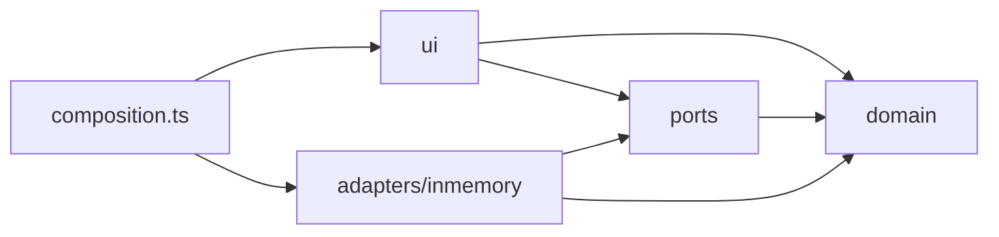

# Spec · Frontend · interfaz completa sobre puertos, sin API todavía

Fecha: 2026-10-12 · Rama: `entrega-2-spec1` · Consigna: [docs/consigna/certiflow-entrega-2.md](../consigna/certiflow-entrega-2.md)

## 1. Objetivo

Construir la interfaz web de todo lo que el sistema hace hoy, **sin hablar con la API**. El backend y su API
siguen cambiando (F1, F2 y F3 todavía no están), así que el frontend define lo que necesita como interfaces
propias (puertos) y corre contra una implementación en memoria que se comporta como el sistema. Cuando la API
esté definida, se escribe un adaptador HTTP detrás de los mismos puertos y las pantallas no cambian.

Es la misma regla de la Clase 7 aplicada al cliente: **los detalles dependen de las reglas de negocio**. Las
pantallas y los puertos son lo estable; de dónde salen los datos (memoria hoy, HTTP después) es el detalle.

### Criterios de aceptación

1. Existe la carpeta `certiflow-frontend/` con una aplicación React + TypeScript (Vite) que arranca con
   `npm install && npm run dev` sin backend ni base de datos.
2. Ningún archivo de `src/ui` importa de `src/adapters`. El único lugar que elige el adaptador es
   `src/composition.ts`.
3. Desde la interfaz se puede ejecutar cada capacidad de la tabla de requisitos de la consigna (§5).
4. La implementación en memoria aplica las reglas de negocio de §4, y los tests de §8 lo comprueban contra el
   puerto, no contra la clase en memoria.
5. Ninguna pantalla decide qué acciones mostrar mirando un estado (`closed`, `status`): las pide al puerto (§3.3).
6. Agregar un tipo de regla nuevo es agregar una entrada en un registro, sin tocar las pantallas (§3.4).
7. CI corre un job propio (`frontend`) con chequeo de tipos, tests y build. El check `build` actual no cambia.
8. No se modifica ningún archivo de `certiflow-domain`, `-application`, `-infrastructure` ni `-web`.

### Fuera de alcance

- Cualquier llamada HTTP, CORS, empaquetado dentro del jar o cambio en la API.
- F1, F2 y F3. Esta fase solo deja los puntos de extensión (§6).
- Autenticación. La persona que actúa se elige en la interfaz (§3.5).
- Subida real de archivos: una evidencia es una referencia de texto, como en el dominio (`Evidence.reference`).
- Paginación: las listas muestran todo. Se agrega junto con el adaptador HTTP.

---

## 2. Tecnología

| Qué | Elección | Por qué |
|---|---|---|
| Build | Vite | Arranque inmediato y build estático que después se puede servir desde cualquier lado. |
| UI | React 19 + TypeScript en modo `strict` | Elegido por el equipo. Los tipos son el contrato de los puertos. |
| Rutas | React Router | Una URL por recurso, igual que la API (`/inspections/INS-1`). |
| Estado | `useState` y un contexto para la sesión | No hay estado global que justifique una librería. |
| Estilos | Una hoja CSS con variables | La consigna pide lo mínimo indispensable. Sin librería de componentes. |
| Tests | Vitest (+ Testing Library solo para lo de §8) | Mismo runner que Vite, sin configuración extra. |

Dependencias de ejecución: `react`, `react-dom`, `react-router-dom`. Nada más.

---

## 3. Arquitectura

```
certiflow-frontend/src
├── domain/          tipos del lenguaje ubicuo, sin lógica (Asset, InspectionSchema, Criterion, Finding, …)
├── ports/           lo que la interfaz le pide al sistema: una interfaz por contexto, sus comandos y sus errores
├── adapters/
│   └── inmemory/    implementación actual: reglas de §4, datos de ejemplo, reloj controlable
├── ui/
│   ├── app/         layout, rutas, sesión (persona que actúa)
│   ├── catalog/  schema/  inspection/  certification/     pantallas por bounded context
│   └── shared/      piezas comunes: errores, bitácora, selector de persona, registro de reglas
└── composition.ts   raíz de composición: único archivo que conoce el adaptador
```



Los contextos son los del backend (`catalog`, `schema`, `inspection`, `certification`, `shared`), para que quien
conoce un lado se ubique en el otro.

**Qué pasa al integrar la API:** se agrega `adapters/http/`, se cambia una línea en `composition.ts` y se borra
`adapters/inmemory/` (o se conserva solo para los tests). `domain/`, `ports/` y `ui/` no se tocan.

### 3.1 Tipos del dominio

Nombres tomados del glosario de DESIGN.md §2.4 y de los enums del dominio, copiados tal cual como uniones de
texto:

```ts
type Outcome = 'PENDING' | 'APPROVED' | 'OBSERVED' | 'REJECTED';
type CertificateStatus = 'ACTIVE' | 'EXPIRED' | 'SUSPENDED' | 'RENEWED';
type IneligibilityReason = 'INSPECTION_NOT_CLOSED' | 'PARTIAL_INSPECTION' | 'BLOCKING_FINDINGS';
type VerificationResult = 'ACCEPTED' | 'REJECTED';
```

Severidades y tipos de evidencia **no** son uniones cerradas, porque en el dominio son conjuntos extensibles
(D2): son datos (`Severity { name, label, outcomeWhenUnmet, blocksCertification }`, `EvidenceKind { name, label }`)
que el puerto entrega (§3.2, `vocabulary()`).

### 3.2 Puertos

Un puerto por contexto. Cada método lleva el nombre de un caso de uso del dominio y recibe su mismo comando,
porque el dominio es el contrato estable y la API no. Todos devuelven `Promise`, así el adaptador HTTP entra sin
cambiar ninguna firma.

```ts
interface InspectionPort {
  assignInspection(command: AssignInspectionCommand): Promise<InspectionId>;
  listInspections(filter: { assetCode?: AssetCode; status?: 'open' | 'closed' }): Promise<InspectionSummary[]>;
  findInspection(id: InspectionId): Promise<InspectionDetails>;
  recordAnswer(command: RecordAnswerCommand): Promise<void>;
  attachEvidence(command: AttachEvidenceCommand): Promise<void>;
  addObservation(command: AddObservationCommand): Promise<void>;
  closeInspection(command: CloseInspectionCommand): Promise<FindingId[]>;
  rectifyInspection(command: RectifyInspectionCommand): Promise<FindingId[]>;
  generateInspectionAct(id: InspectionId): Promise<InspectionAct>;
}

interface RecordAnswerCommand {
  inspectionId: InspectionId; criterionCode: string; answer: RawAnswer; answeredBy: Person;
}
```

| Puerto | Métodos |
|---|---|
| `CatalogPort` | `registerAsset`, `findAsset`, `listAssets` |
| `SchemaPort` | `createInspectionSchema`, `publishSchemaVersion`, `findSchema`, `listSchemas`, `vocabulary` |
| `InspectionPort` | los de arriba |
| `FindingPort` | `listFindings`, `findFinding`, `planCorrectiveAction`, `verifyCorrectiveAction`, `generateFindingsSummary` |
| `CertificationPort` | `evaluateCertification`, `issueCertificate`, `listCertificates`, `findCertificate`, `suspendCertificate`, `renewCertificate`, `generateCertificateDocument` |
| `AuditPort` | `auditHistory(subject)` con `subject` = activo, esquema, inspección, hallazgo o certificado |

`Certiflow` agrupa los seis y es lo que la raíz de composición entrega a la interfaz por contexto de React.

### 3.3 Acciones disponibles: las decide el sistema, no la pantalla

Cada recurso que se lee trae la lista de lo que se puede hacer con él en ese momento:

```ts
type InspectionAction = 'recordAnswer' | 'attachEvidence' | 'addObservation' | 'closeInspection'
                      | 'rectifyInspection' | 'generateInspectionAct';

interface InspectionDetails { /* … */ actions: InspectionAction[]; }
```

La pantalla muestra un botón por cada acción presente y nada más. Hoy la lista la calcula el adaptador en
memoria; mañana el adaptador HTTP la arma con los `_links` de HAL, que ya traen solo las transiciones válidas
(D21). Así una transición nueva de F1 a F3 es un valor más en la unión y un botón más, y ninguna pantalla repite
la regla "si está cerrada, entonces…".

| Recurso | Acciones |
|---|---|
| Activo | `assignInspection` (si su tipo tiene esquema) |
| Esquema | `publishSchemaVersion` |
| Inspección abierta | `recordAnswer`, `attachEvidence`, `addObservation`, `closeInspection` |
| Inspección cerrada | `rectifyInspection`, `generateInspectionAct` |
| Decisión de elegibilidad | `issueCertificate` (si es elegible) |
| Hallazgo abierto | `planCorrectiveAction` |
| Acción correctiva abierta | `verifyCorrectiveAction` |
| Certificado | `suspendCertificate` (si está `ACTIVE`), `renewCertificate` (si no está `RENEWED`) |

Emitir un certificado no es una acción de la inspección sino de la **decisión de elegibilidad**
(`evaluateCertification`), igual que en el backend: Certificación decide sobre el resultado de la inspección y no
al revés (D16). La pantalla de la inspección ya consulta la elegibilidad para mostrar los motivos, y la
renovación usa la misma decisión.

### 3.4 Registro de tipos de regla

Todo lo que depende del tipo de regla de un criterio vive en un registro con una entrada por tipo:

```ts
interface RuleKind<R extends ApprovalRule> {
  type: R['type'];                 // 'numeric-range' | 'yes-no' | 'option-in-list'
  label: string;
  ConfigFields: Component<…>;      // campos del editor de esquemas (unidad, mínimo, máximo…)
  AnswerInput: Component<…>;       // control con el que el inspector responde
  describe(rule: R): string;       // texto de solo lectura: "entre 10 y 16 bar"
  formatAnswer(answer: RawAnswer): string;
}
```

El editor de esquemas, la ejecución de la inspección, el acta y el hallazgo lo consultan. Es el Strategy con
selección por tipo de la Clase 2, del lado del cliente. La demostración sugerida pide "al menos ocho tipos de
criterios": cada tipo nuevo que agregue el backend es una entrada más acá.

### 3.5 Sesión: quién actúa

No hay login. En el encabezado se elige la persona que actúa, de una lista de ejemplo definida en un solo
archivo (`ui/app/roster.ts`: quien asigna, inspector, responsable del activo, verificador, emisor), con la opción
de escribir otra (`id` y `nombre`). La elección se recuerda en el navegador. Cada comando la lleva en su campo
(`answeredBy`, `closedBy`, `verifier`…), como en el dominio; el adaptador HTTP la pasará a los headers
`X-Person-Id` y `X-Person-Name`. Los formularios que piden una persona (responsable, inspector) usan el mismo
selector.

### 3.6 Errores

Los puertos rechazan con `DomainError { name, message, ineligibilities? }`, donde `name` es el nombre de la
excepción del dominio (`InspectionIncompleteException`, `VerifierMustDifferFromResponsibleException`…). Un único
componente los muestra. El adaptador HTTP los armará desde `application/problem+json`, que ya trae ese nombre en
`title`.

### 3.7 Herramientas de demostración

El adaptador en memoria ofrece además un objeto `DemoControls` para cambiar **la fecha de hoy** (equivalente al
`MutableClock` de los tests del backend; hace falta para mostrar una acción vencida o un certificado expirado).
La interfaz muestra ese control solo si la raíz de composición lo entrega. Con el adaptador HTTP no existe y el
control desaparece solo. Los datos viven en memoria: recargar la página vuelve a los datos de ejemplo.

---

## 4. Comportamiento de la implementación en memoria

Aplica los supuestos de DESIGN.md §1 con el mismo nombre de excepción cuando rechaza algo.

| Supuesto | En memoria |
|---|---|
| S1 La inspección captura la versión vigente al asignarse | Sí |
| S2 Un esquema por tipo de activo, versiones consecutivas | Sí (`SchemaAlreadyDefinedForAssetTypeException`) |
| S3 Aprobado, observado, rechazado y pendiente según regla, severidad y evidencia exigida | Sí |
| S4 Cerrar exige alcance completo y levanta un hallazgo por no conformidad | Sí (`InspectionIncompleteException`) |
| S5 Bloquean los hallazgos abiertos de severidad `MAJOR` y `CRITICAL` | Sí |
| S6 Rectificar agrega una revisión y levanta hallazgo si reintroduce una no conformidad sin hallazgo abierto | Sí |
| S7 Revisión 1 al cerrar, una más por rectificación, ninguna se modifica | Sí |
| S8 Acción correctiva: verificador distinto del responsable, notas obligatorias al rechazar, vencimiento, aceptar cierra el hallazgo y cancela las demás | Sí |
| S9 Vigencia con extremos incluidos; `EXPIRED` derivado de la fecha | Sí |
| S10 Un certificado vigente por activo; solo se suspende uno `ACTIVE` | Sí |
| S11 Renovar exige una inspección posterior del mismo activo y elegible; el anterior queda `RENEWED` | Sí |
| S12 Rango cerrado; mínimo mayor que máximo es inválido | Sí |
| S13 Evidencia exigida por tipo y cantidad; la misma referencia dos veces se rechaza | Sí |
| S14 Las personas son iguales por `id` | Sí |
| S15 Identidades | **Simplificado**: ids secuenciales (`INS-1`, `FND-1`, `CERT-1`); el formato real lo define el backend |
| S17 Alcance completo o por secciones; una inspección parcial no certifica | Sí |
| S18 Características con nombres únicos | Sí |
| S19 Quien asigna no inspecciona; el responsable del activo no asigna ni inspecciona | Sí |
| Bitácora | Sí, con los mismos nombres de acción (`ASSIGNED`, `ANSWER_RECORDED`, `RAISED`, `ISSUED`…) |
| Escala decimal (`7.00` vuelve como `7.00`) | **Simplificado**: el valor se guarda como se escribió y se compara como número |
| Transacciones, concurrencia, `ETag`, paginación | **No**: no aplican en memoria |

**Datos de ejemplo**, pensados para la demostración sugerida: dos activos de tipos distintos; un esquema con dos
secciones y ocho criterios que usan los tres tipos de regla, con dos versiones; una inspección abierta que sigue
en la versión 1; una inspección cerrada con hallazgos `MINOR`, `MAJOR` y `CRITICAL`; una acción correctiva vencida;
un certificado activo y uno suspendido.

---

## 5. Pantallas

Navegación principal: Activos · Esquemas · Inspecciones · Hallazgos · Certificados.

| Capacidad de la consigna | Pantalla | Ruta |
|---|---|---|
| Catálogo de activos | Lista con filtro por tipo; alta; detalle con características | `/assets`, `/assets/new`, `/assets/:code` |
| Esquemas de inspección | Lista; alta con editor de secciones, criterios, regla, severidad y evidencia exigida | `/schemas`, `/schemas/new` |
| Versionado | Detalle del esquema con sus versiones; ver una versión; publicar una nueva partiendo de la vigente | `/schemas/:assetType`, `…/versions/:n`, `…/versions/new` |
| Asignación | Formulario: activo, inspector, fecha prevista, alcance completo o por secciones | `/inspections/new` |
| Ejecución | Detalle de la inspección: por criterio, responder (control según la regla), adjuntar evidencia, observar | `/inspections/:id` |
| Evaluación | En la misma pantalla: resultado por criterio y avance del alcance; botón de cierre | `/inspections/:id` |
| Rectificación | En la inspección cerrada: formulario con criterio, respuesta nueva y motivo; lista de revisiones | `/inspections/:id` |
| Hallazgos | Lista con filtro por activo; detalle con severidad, evidencia y responsable | `/findings`, `/findings/:id` |
| Acciones correctivas | En el hallazgo: planificar, ver vencimiento, verificar (aceptar o rechazar con notas) | `/findings/:id` |
| Certificación | Elegibilidad con sus motivos en la inspección; emitir; lista; detalle con suspender y renovar | `/certificates`, `/certificates/:number` |
| Auditoría | Sección "Historial" en el detalle de activo, esquema, inspección, hallazgo y certificado | en cada detalle |
| Informes | Acta de inspección, resumen de hallazgos del activo y documento del certificado, imprimibles | `/inspections/:id/act`, `/assets/:code/findings-summary`, `/certificates/:number/document` |

Toda la interfaz está en inglés, igual que las etiquetas y los mensajes del dominio.

---

## 6. Puntos de extensión para F1, F2 y F3

Ninguno se implementa ahora. La tabla dice qué se agrega y dónde cuando cada uno llegue.

| Funcionalidad | Interfaz | Puertos y tipos | En memoria (si todavía existe) |
|---|---|---|---|
| **F2** Versiones con vigencia futura | Campo opcional "vigente desde" al publicar; columna y etiqueta "programada" en la lista de versiones; consulta "qué versión regía en una fecha" | `PublishSchemaVersionCommand.effectiveFrom?`; `SchemaVersion.effectiveFrom`; `SchemaPort.versionInForceOn(assetType, date)` | La versión que captura una inspección sale de `versionInForceOn(hoy)` en lugar de "la última" |
| **F3** Políticas por jurisdicción | Jurisdicción en el alta y el detalle del activo; "política aplicada" en la elegibilidad y en el certificado; certificado condicional como un estado más | `Asset.jurisdiction`; `CertificationDecision.policy`; valores nuevos en `CertificateStatus` e `IneligibilityReason` | La elegibilidad ya es una función aislada; pasa a elegirse por la jurisdicción del activo |
| **F1** Certificados parciales por subsistema | Subsistema en secciones o criterios del editor; resultado por subsistema en la inspección; certificados agrupados por subsistema y el global derivado | `Section.subsystem?` o `Criterion.subsystem?`; `Certificate.subsystem?`; resultado por subsistema en `CertificationDecision` | Emisión por subsistema y política que deriva el global |
| Más tipos de criterio | Nada: los toma del registro | Una variante más de `ApprovalRule` y de `RawAnswer` | Una función de evaluación más |

Lo que hace baratos estos cambios ya está en §3: acciones entregadas por el puerto (§3.3), reglas en un registro
(§3.4), severidades y evidencias como datos (§3.1), y estados que se muestran con la etiqueta que llega.

### Lo que la integración le va a pedir a la API

No se pide ahora. Queda anotado para cuando se defina la API final:

1. Listar esquemas (hoy solo se busca por tipo de activo).
2. Exponer severidades, tipos de evidencia y tipos de regla, o aceptar que el cliente los tenga fijos.
3. Seguir entregando solo los `_links` de las transiciones válidas (ya lo hace). Los `rel` de HAL son
   sustantivos (`closure`, `rectifications`, `suspensions`, `renewals`, `corrective-actions`, `verifications`) y
   las acciones del puerto son los verbos de los casos de uso: la tabla que traduce de uno a otro vive en el
   adaptador HTTP. El puerto no se renombra para parecerse a la API.
4. Decidir cómo se sirve el frontend: mismo origen (estáticos dentro del jar o un proxy) o CORS.

---

## 7. Integración continua y repositorio

- `.github/workflows/ci.yml` gana un job `frontend`, independiente de `build`: `actions/setup-node` (Node 24, caché
  de npm), y en `certiflow-frontend/`: `npm ci`, `npm run typecheck`, `npm test`, `npm run build`. No se cambian
  los disparadores (hoy un push a `entrega-2-spec1` no corre CI; sí lo hace el pull request a `main`).
- `.gitignore`: `node_modules/` y `dist/`.
- `.editorconfig`: sangría de 2 espacios para `ts`, `tsx`, `js`, `json`, `css` y `html`.

---

## 8. Tests

| Tipo | Qué |
|---|---|
| De contrato del puerto | Una suite que recibe una fábrica de `Certiflow` y recorre el negocio: el flujo completo (alta → esquema → inspección → cierre → hallazgo → acción → certificado) y cada regla de §4 con el nombre de su excepción. Hoy corre contra el adaptador en memoria; mañana la misma suite corre contra el HTTP. No se tira nada al integrar. |
| De acciones | Cada recurso ofrece exactamente las acciones de §3.3 según su estado (parametrizado). |
| De interfaz, mínimos | El registro de reglas muestra el control correcto por tipo; una pantalla muestra solo los botones de las acciones que recibe; el error de dominio se muestra con su mensaje. |

Los nombres de los tests describen el comportamiento de negocio, como en el backend.

---

## 9. Documentación

- `certiflow-frontend/README.md`: cómo correrlo, estructura y cómo se conecta la API (qué archivo se agrega y
  cuál se cambia).
- `README.md` de la raíz gana una sección "Frontend" y `CHANGES.md` una entrada.
- `DESIGN.md` gana la decisión D22:

  > **D22. Frontend sobre puertos.** *Principio:* DIP; los detalles dependen del negocio (Clase 7). *Dónde:*
  > `certiflow-frontend/src/ports`, `adapters/inmemory`, `composition.ts`. *Por qué:* la API seguía cambiando
  > mientras se construía la interfaz; con los puertos nombrados como los casos de uso, la interfaz se pudo
  > terminar antes y la integración es un adaptador. *Alternativas descartadas:* llamar a la API actual (se
  > rompe con cada cambio de F1 a F3); datos fijos sin reglas (no permite recorrer el flujo). *Costo:* las reglas
  > de §4 están escritas dos veces mientras exista el adaptador en memoria.

---

## 10. Orden de implementación

Rebanadas verticales: cada paso deja algo usable, con sus tests en verde, y se commitea por separado.

1. Proyecto Vite, estructura de carpetas, job de CI, `.gitignore`, `.editorconfig`.
2. `domain`, `ports`, errores, sesión, layout y navegación; adaptador en memoria vacío con sus datos de ejemplo.
3. Catálogo: lista, alta, detalle e historial.
4. Esquemas: registro de reglas, editor, versiones.
5. Inspecciones: asignación, ejecución, evaluación, cierre, revisiones, rectificación, acta.
6. Hallazgos y acciones correctivas, resumen de hallazgos.
7. Certificación: elegibilidad, emisión, suspensión, renovación, documento.
8. Control de la fecha de hoy, README del frontend, sección en el README de la raíz, D22 en DESIGN.md y CHANGES.md.

---

## 11. Decisiones confirmadas (2026-10-12)

1. **Secciones planas**, como `Section` en el dominio. Si el backend las vuelve anidadas, `Section` gana
   `subsections` y el editor y la ejecución pasan a recorrerlas de forma recursiva.
2. **Simplificaciones de §4 aceptadas** por ahora: ids secuenciales, escala decimal y sin paginación.
3. **Datos solo en memoria**: se pierden al recargar. No se guardan en el navegador.
4. **Se editan `DESIGN.md` (D22) y el `README.md` de la raíz** en esta fase.
5. **Commits sin `Co-Authored-By`** ni otra atribución, como en la fase 1.
